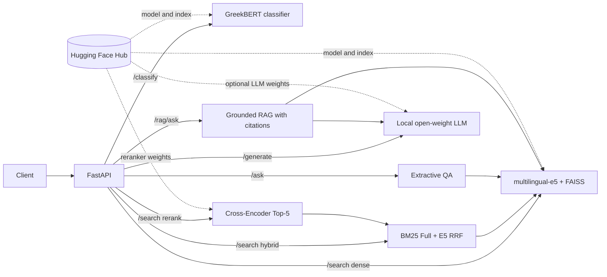
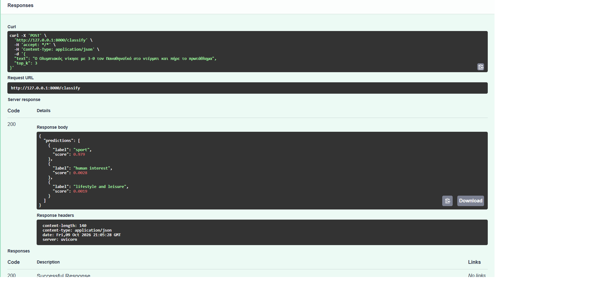
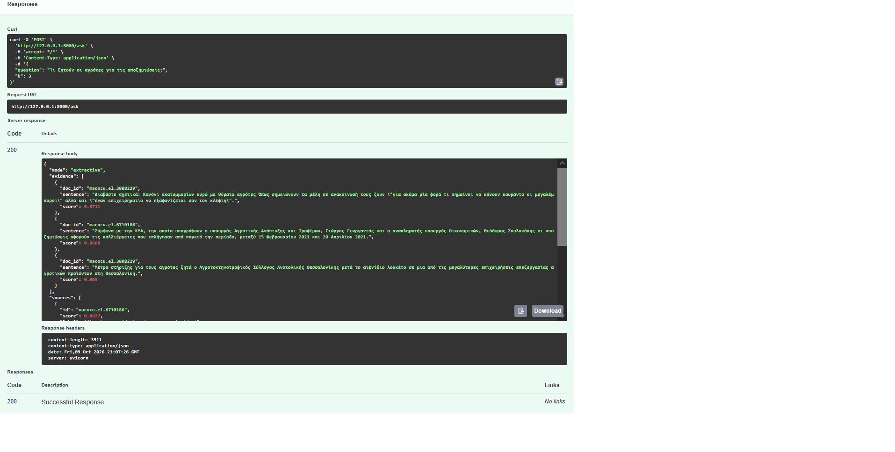

# Greek News NLP API

[](https://github.com/P-Tilemachos/Greek-News-NLP-API/actions/workflows/ci.yml)


A REST API for Greek news: topic classification with a fine-tuned **GreekBERT**, semantic search (dense, hybrid and reranked), extractive question answering with cited evidence, and grounded generative answers. Built with FastAPI, packaged with Docker and tested in CI. The repository also documents the experiments behind it: a benchmark of GreekBERT against zero-shot and QLoRA fine-tuned LLMs, and several retrieval evaluations.

## Highlights

- **Classification.** Fine-tuned GreekBERT on 17 IPTC topics reaches 0.825 accuracy and 0.770 macro-F1 on 788 test articles, against 0.753 / 0.667 for a TF-IDF baseline.
- **LLM comparison.** Benchmarked against zero-shot Qwen2.5 (1.5B, 3B) and a QLoRA fine-tuned Qwen2.5-1.5B on the same test set. GreekBERT scored highest (+8.3 macro-F1 points over QLoRA, 95% bootstrap CI +3.2 to +14.1) and had the lowest latency in a single-request T4 benchmark.
- **Retrieval.** Dense search (multilingual-e5 + FAISS), hybrid search (BM25 + dense with Reciprocal Rank Fusion) and Top-5 cross-encoder reranking, evaluated on 480 frozen synthetic queries. On later-sentence queries, Recall@1 rises from 0.31 (dense) to 0.50 (hybrid) and 0.71 (with reranking).
- **Question answering.** The extractive `/ask` endpoint returns the source article at rank 1 for 95% of 40 answerable questions. `/rag/ask` adds grounded generative answers with citations and abstention; a Phase 15 exploratory evaluation documented 100% abstention (80/80), so answer-generation faithfulness remains unassessed.
- **Engineering.** FastAPI, Docker image, GitHub Actions (lint, format check, tests, Docker build with a health check), and models and index hosted on the Hugging Face Hub and loaded lazily.
- **Transparent evaluation.** Benchmarks disclose label provenance, sampling assumptions, and limitations, including the Phase 15 over-abstention finding.

## Architecture



## Results

Classification on the 788-article test split (17 IPTC Media Topic categories). Macro-F1 is the main metric because the classes are imbalanced (sport has about 900 articles, weather about 30).

| Model | Accuracy | Macro-F1 |
|---|---|---|
| TF-IDF + Logistic Regression (baseline) | 0.753 | 0.667 |
| **GreekBERT (fine-tuned)** | **0.825** | **0.770** |

The fine-tuned model is published on the Hugging Face Hub with a model card: [Tilemachos-P/greek-news-classifier](https://huggingface.co/Tilemachos-P/greek-news-classifier).

LLM benchmark on the same test articles (GreekBERT was re-evaluated in this run, which gave 0.834 / 0.775; see the [benchmark report](docs/benchmarks.md) for the difference):

| Model | Accuracy | Macro-F1 |
|---|---|---|
| GreekBERT (fine-tuned) | **0.834** | **0.775** |
| Qwen2.5-1.5B + QLoRA | 0.777 | 0.696 |
| Qwen2.5-3B, zero-shot | 0.629 | 0.518 |
| Qwen2.5-1.5B, zero-shot | 0.486 | 0.402 |

Confidence intervals, latency, VRAM and caveats are in [docs/benchmarks.md](docs/benchmarks.md).

## Phase 15 — Grounded RAG evaluation (exploratory)

A saved-prediction evaluation of `POST /rag/ask` was run locally with
`Qwen/Qwen2.5-1.5B-Instruct` on CPU. It used **40 author-reviewed answerable
questions** and **40 provisional unanswerable candidates**. Two cases were
used as development pilots; the remaining 78 are reported separately.
The author recorded reviews for all 80 abstentions; this is **not**
an independent, blinded evaluation or a validated gold benchmark.

| Metric | 78 cases (excluding development pilots) | All 80 (including pilots) |
|---|---:|---:|
| Saved predictions | 78 / 78 | 80 / 80 |
| Answers generated | **0 / 78** | **0 / 80** |
| Abstentions | 78 / 78 (100%) | 80 / 80 (100%) |
| Answerable questions answered | 0 / 39 (0%) | 0 / 40 (0%) |
| Correct reference article among returned sources | 37 / 39 (94.87%) | 38 / 40 (95.00%) |
| Review records (author, all 80) | 78 included in the 80-case review | 80 / 80 |

**Finding:** the evaluated pipeline exhibits severe **over-abstention**:
reference documents are often retrieved, but the system produces no answers.
A reference-document hit only establishes document-ID overlap, not that the
answer-bearing passage was available to the generator or that a citation
supports an answer. A development example retrieved the album title `Moss`
verbatim and still abstained.

Because **no answers were generated**, answer correctness, generated-answer
faithfulness and hallucination rates are **N/A**, not zero. The negative labels
remain provisional and are not proof of corpus-wide unanswerability. Some
negative-review decisions remain uncertain. Author review is not a substitute
for independent annotation or adjudication. The original 78-case report may
show `human_reviewed: 0` because it scores the saved predictions separately;
the 80-case reviewed report contains all author annotations.

The pilot and its evaluation code passed **86 pytest tests** and
**`ruff check .`** locally on 1 November 2026. These checks validate the
workflow, **not** generative answer quality. Local predictions, source excerpts,
review records and other run artifacts remain excluded from Git.

See [Phase 15 protocol, findings and limitations](docs/phase_15_rag_evaluation.md)
for dataset caveats, detailed metrics and offline reproduction commands.

## API

| Endpoint | Description |
|---|---|
| `GET /health` | API liveness check; does not verify model or index readiness |
| `POST /classify` | Top-k predicted categories with scores for a Greek text |
| `POST /search` | Dense E5/FAISS by default; opt-in `mode: "hybrid"` (BM25 + E5 + RRF) or `mode: "rerank"` (hybrid + Cross-Encoder Top-5) |
| `POST /ask` | Extractive question answering: the most relevant sentences with article ids, plus the source articles |
| `POST /rag/ask` | Grounded generative answer with source citations and abstention |
| `POST /generate` | Optional ungrounded local text generation with a bounded open-source LLM |

Example `/classify` request:

```json
{
  "text": "Η κυβέρνηση ανακοίνωσε νέα μέτρα στήριξης για τους αγρότες λόγω των πλημμυρών",
  "top_k": 3
}
```

Example `/search` request with hybrid retrieval:

```json
{"query": "πλημμύρες και αποζημιώσεις αγροτών", "k": 5, "mode": "hybrid"}
```

Omitting `mode` keeps dense-only search. Interactive documentation (Swagger) is available at `/docs` when the server is running.

## Demo

Screenshots of the API running locally (Swagger UI).





## Quickstart

Use Python 3.11 inside an activated virtual or Conda environment:

```bash
git clone https://github.com/P-Tilemachos/Greek-News-NLP-API.git
cd Greek-News-NLP-API
python -m pip install -e ".[dev,ml]"
```

Configure the public Hugging Face repositories and start the API.

**Windows (Command Prompt / Anaconda Prompt):**

```bat
set "HF_MODEL_REPO=Tilemachos-P/greek-news-classifier"
set "HF_INDEX_REPO=Tilemachos-P/greek-news-index"
python -m uvicorn greek_nlp.api.main:app --reload
```

**Linux / macOS (Bash):**

```bash
export HF_MODEL_REPO=Tilemachos-P/greek-news-classifier
export HF_INDEX_REPO=Tilemachos-P/greek-news-index
python -m uvicorn greek_nlp.api.main:app --reload
```

Open [Swagger UI](http://127.0.0.1:8000/docs) to try the endpoints. The first request to each component may take longer while its artifacts are downloaded and loaded. Initial downloads require internet access.

Model weights and the search index are not stored in this repository. They are loaded from `models_store/` (`greek-bert-news-classifier/` and `rag_index/`). If a folder is missing, the API downloads it from the Hugging Face Hub, using these environment variables:

| Variable | Purpose |
|---|---|
| `HF_MODEL_REPO` | Hub repository containing the fine-tuned classifier |
| `HF_INDEX_REPO` | Hub repository containing the FAISS index and article texts |
| `HF_TOKEN` | Access token, only needed for private repositories |
| `MODELS_DIR` | Optional: custom location of the local model store |

The index can be rebuilt locally with `python -m greek_nlp.rag.retriever` after running the data notebooks.

## Docker

Run these commands from the repository root with Docker running:

```bash
docker build -t greek-news-nlp-api .
docker run --rm -p 8000:8000 -e HF_MODEL_REPO=Tilemachos-P/greek-news-classifier -e HF_INDEX_REPO=Tilemachos-P/greek-news-index greek-news-nlp-api
```

This example does not mount persistent storage, so downloaded artifacts inside the container are removed when it is deleted. The classifier ([greek-news-classifier](https://huggingface.co/Tilemachos-P/greek-news-classifier)) and the search index ([greek-news-index](https://huggingface.co/datasets/Tilemachos-P/greek-news-index)) are public on the Hugging Face Hub, so no token is needed.

## Tests and CI

```bash
python -m pytest -q
python -m ruff check .
python -m ruff format --check .
```

The test suite covers API responses and input validation using mocked inference components, plus artifact download path handling using a simulated Hub download. Tests do not download model weights or require a Hugging Face token. CI runs on pushes to `main` and pull requests, with separate jobs for lint, formatting, tests, and a Docker image build with a `/health` smoke test. These checks do not establish real-model inference quality.

## Documentation

- [LLM and GPU inference benchmarks](docs/benchmarks.md)
- [Retrieval evaluation: dense, hybrid and reranking](docs/retrieval.md)
- [Extractive QA evaluation](docs/qa_evaluation.md)
- [Phase 15 — Grounded RAG exploratory evaluation](docs/phase_15_rag_evaluation.md)
- Integration guides: [hybrid search](docs/phase_11_hybrid_integration.md), [reranking](docs/phase_12_reranking_integration.md), [local LLM generation](docs/phase_13_local_llm_integration.md)
- [Reproducing the experiments](docs/reproducing.md)
- [Full list of limitations](docs/limitations.md)

## Project structure

```
src/greek_nlp/
  api/       FastAPI app and request/response schemas
  core/      model and index download from the Hugging Face Hub
  models/    GreekBERT inference
  rag/       Dense FAISS, hybrid retrieval, reranking, extractive QA and grounded RAG
  evaluation/  Offline grounded RAG scorer and review import/export
notebooks/   experiments and offline reporting notebooks
scripts/     collection, reporting and developer utilities
evaluation/  public schema and run-metadata templates (not private review data)
results/     local benchmark and evaluation outputs (Phase 15 local data ignored)
docs/        screenshots, reports and integration guides
tests/       pytest suite (models are mocked, so CI needs no weights)
Dockerfile   CPU image of the API
```

## Data

[EMMediaTopic 1.0](http://hdl.handle.net/11356/1991) (Kuzman and Ljubešić, Jožef Stefan Institute), Greek subset: 5,250 news articles, licensed under CC BY-SA 4.0. The data files are not stored in this GitHub repository. The article texts are included in the search index dataset on the Hugging Face Hub ([greek-news-index](https://huggingface.co/datasets/Tilemachos-P/greek-news-index)), which is distributed under the same CC BY-SA 4.0 license. Re-split 70/15/15 (stratified, seed 42) into train, validation and test.

## Limitations

- Labels were assigned automatically by GPT-4o, so classification metrics measure agreement with those labels, not verified human ground truth.
- Rare categories (weather, lifestyle and leisure, religion) have very few test examples, so their per-class scores are noisy.
- Classification and dense embeddings use a maximum sequence length of 256 tokens.
- The retrieval evaluations use automatically generated, source-excerpt queries. Full-text BM25 matches them perfectly, and this does not generalize to real user questions.
- `/ask` is extractive and has no answerability threshold. In the Phase 15 exploratory `/rag/ask` run, all 80 questions were abstained on, so response faithfulness, correctness and hallucination rates could not be measured. `/generate` output is ungrounded.
- The LLM benchmark is a single run per model on one dataset, and the identity of the re-evaluated GreekBERT checkpoint relative to the historical one is unresolved.
- Phase 15 negative-case labels are provisional, the two development cases are not held out, and the 80 author reviews are not independent blinded judgments.
- There is no public live demo (a Hugging Face Spaces attempt was blocked by the free-tier CPU quota).

The full list is in [docs/limitations.md](docs/limitations.md).

## Roadmap

### Completed

- [x] Data preprocessing, stratified splitting and TF-IDF baseline.
- [x] GreekBERT fine-tuning, classification evaluation and `/classify` API.
- [x] Dense semantic retrieval with multilingual-e5 and FAISS, and extractive `/ask`.
- [x] Docker packaging, automated tests, GitHub Actions CI and Hugging Face model card.
- [x] Open-source LLM benchmarking and controlled Tesla T4 inference evaluation.
- [x] Offline BM25, Dense E5, Hybrid RRF and Cross-Encoder reranking evaluations.
- [x] Extractive QA benchmark with 40 answerable questions (Notebook 10).
- [x] Phase 11 — Opt-in hybrid retrieval integration into `/search`.
- [x] Phase 12 — Opt-in Cross-Encoder reranking integration into `/search`.
- [x] Phase 13 — Local open-source LLM generation through `/generate`.
- [x] Phase 14 — Grounded generative RAG through `/rag/ask`, with source citations, evidence-based safe retry and abstention support. Offline tests and selected real-model smoke tests passed.
- [x] Phase 15 — Exploratory grounded RAG evaluation workflow, 80 saved predictions, author review and transparent baseline reporting (100% abstention; no generated answers to assess).

### Planned Improvements

- [ ] Reconcile historical GreekBERT checkpoints and results, and improve reproducibility of matched-input model comparisons.
- [ ] Implement overlapping, passage-level chunking and indexing of full articles, with retrieval evaluation.
- [ ] Evaluate retrieval relevance using independently authored, human-assessed queries before considering hybrid retrieval as the default.
- [ ] Investigate Phase 15 over-abstention and evidence-span selection; independently verify negative labels, then run a fresh held-out assessment of answer correctness, faithfulness and hallucinations.
- [ ] Deploy a public live demo (previous Hugging Face Spaces attempt was limited by the free-tier CPU quota).

### Upcoming Phases

- [ ] Phase 16 — Optimize quantization, streaming, latency, memory usage and inference performance through controlled comparisons.
- [ ] Phase 17 — Expand end-to-end integration and regression tests, strengthen CI and documentation, and prepare v2 release validation.
