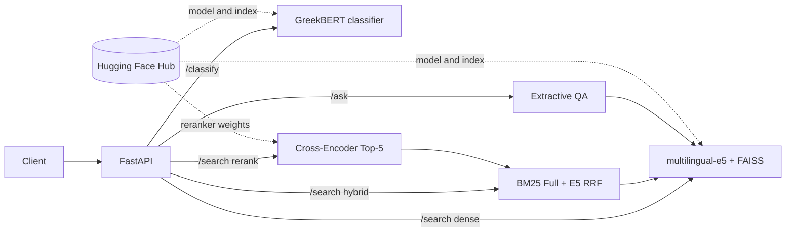
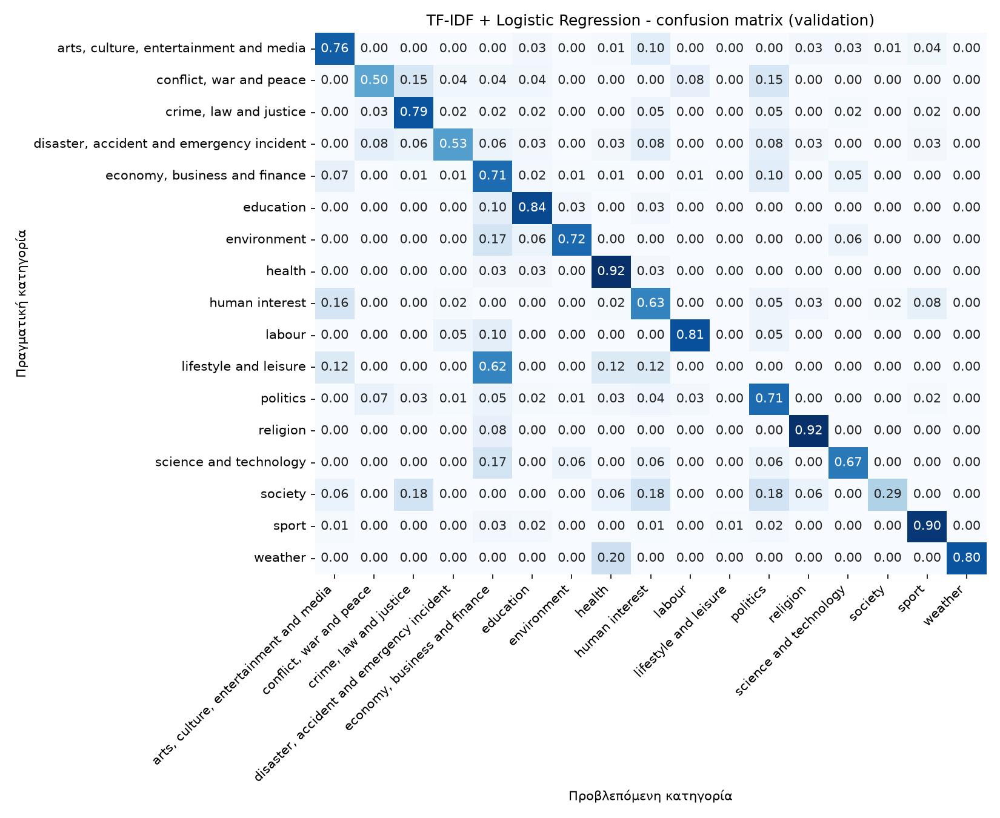
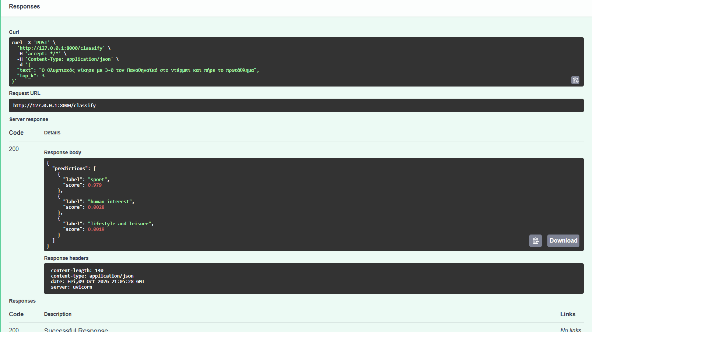
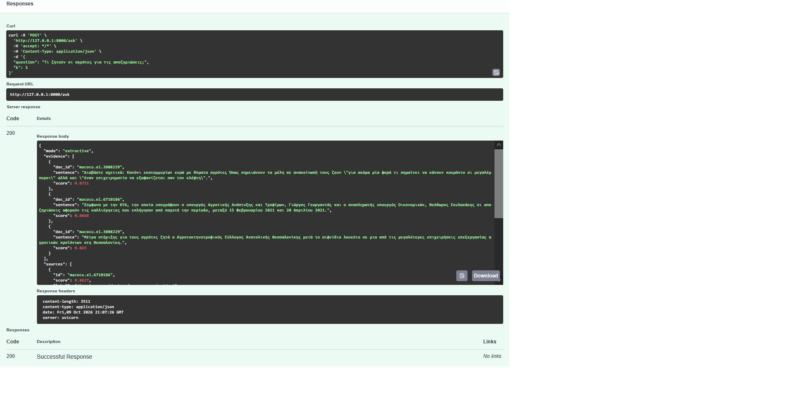

# Greek News NLP API


Greek news classification and retrieval-based extractive question answering served through a REST API: a fine-tuned **GreekBERT** classifier (evaluated against a TF-IDF baseline), semantic search with multilingual-e5 and FAISS, and an extractive `/ask` endpoint that returns cited evidence sentences. Packaged with Docker and tested in CI. The repository also contains a [benchmark of open-source LLMs](#llm-benchmark) (zero-shot and QLoRA fine-tuned) against the GreekBERT classifier and an [offline comparison of BM25, dense and hybrid retrieval](#hybrid-retrieval-benchmark-v2-notebook-08). The repository also provides a [controlled four-configuration Tesla T4 inference benchmark](#controlled-gpu-inference-benchmark-notebook-07) (Notebook 07). Hybrid search and Cross-Encoder reranking are now available as opt-in `/search` modes; the default `/search` and `/ask` remain dense-only.

## Architecture



## Results

Original classification results on the 788-article test split (17 IPTC Media Topic categories). The classifier was trained on the training split, with model selection on validation. Subsequent LLM experiments also used this test split; their evaluation history is documented below.

| Model | Accuracy | Macro-F1 |
|---|---|---|
| TF-IDF + Logistic Regression (baseline) | 0.753 | 0.667 |
| **GreekBERT (fine-tuned)** | **0.825** | **0.770** |

Macro-F1 is the main metric because the classes are imbalanced (sport has about 900 articles, weather about 30). The fine-tuned model is published on the Hugging Face Hub with a model card: [Tilemachos-P/greek-news-classifier](https://huggingface.co/Tilemachos-P/greek-news-classifier).



*Confusion matrix of the TF-IDF baseline on the validation set.*

## LLM Benchmark

Does an open-weight LLM beat a fine-tuned GreekBERT on Greek news topic classification (17 IPTC topics)? The final comparison below uses the same 788 test articles for four model configurations, with matching document IDs and reference labels. Prompt variants and QLoRA epochs were compared on the validation split (787 articles).

**Evaluation history:** an initial free-generation smoke test used 100 articles sampled from the test split before the subsequent prompting experiments. The full test split was then used for the final comparison. It was therefore not completely untouched during development. The confidence intervals below describe sampling uncertainty on this test set; they do not account for possible bias from its earlier use.

### Test-set results

| Model | Accuracy (95% CI) | Macro-F1 (95% CI) | s/article* | Peak VRAM* |
|---|---|---|---|---|
| GreekBERT (fine-tuned) | **0.834** (0.810–0.860) | **0.775** (0.731–0.811) | 0.016 | 1.6 GB |
| Qwen2.5-1.5B + QLoRA | 0.777 (0.746–0.806) | 0.696 (0.639–0.732) | 0.252 | 3.6 GB |
| Qwen2.5-3B, zero-shot | 0.629 (0.596–0.665) | 0.518 (0.473–0.554) | 0.472 | 8.4 GB |
| Qwen2.5-1.5B, zero-shot | 0.486 (0.452–0.520) | 0.402 (0.351–0.438) | 0.245 | 5.1 GB |

95% confidence intervals come from 1,000 bootstrap resamples of the test set. GreekBERT minus QLoRA: +5.8 points accuracy (CI +2.9 to +8.8) and +8.3 points macro-F1 (CI +3.2 to +14.1).

GreekBERT was re-evaluated on the same test articles as the LLMs, using `text_clean`, a 256-token limit and batch size 8. This run gives 0.834 / 0.775, compared with the historical 0.825 / 0.770 in [Results](#results). A later [preprocessing audit](notebooks/06_greekbert_audit.ipynb) found that applying the original normalization changed just 2 of 788 test predictions (raw 0.8338 / 0.7750; normalized 0.8363 / 0.7776). The original score difference remains unresolved, and checkpoint identity with the historical run has not been established. These scores are reported as separate evaluations, not as an established model improvement.

\*Historical measurements on Colab T4, batch 8. GreekBERT and reloaded QLoRA timings cover synchronized forward passes on validation; the final zero-shot timings include tokenization, device transfer, forward passes and prediction extraction on test. No consistent warm-up protocol was used. VRAM is peak PyTorch allocated memory, not total device memory, and isolation from other live tensors was not verified. These figures are indicative and are not a controlled latency or memory comparison. Seconds per article at batch 8 is amortized processing time, not single-request API latency.

### Findings

- **The tested QLoRA configuration improved classification.** It lifted the 1.5B model by about 29 percentage points in both accuracy and macro-F1 and beat the 3B zero-shot configuration. Prompt format, article length and precision also differ, so this is not an isolated ablation of fine-tuning alone.
- **GreekBERT achieved the highest classification scores in this comparison.** The historical batch-8 speed and memory measurements above are not directly comparable across models. A separate batch-1 [GPU inference benchmark](#controlled-gpu-inference-benchmark-notebook-07) reports measured timing and allocated VRAM; it does not isolate the reason for GreekBERT’s classification advantage.
- **The tested few-shot setup did not improve validation accuracy** (0.485 vs 0.510 zero-shot). It used one training example per class and about 7,000 prompt tokens per article. Few-shot was not evaluated in the final test comparison; this result does not establish that other example selections or prompting strategies would fail.
- **Output format matters for small LLMs.** Asking for a letter (A to Q) collapsed to a single answer (validation accuracy 0.056). Scoring the first token of each label name worked. Scoring full label strings gave no gain on a 200-article validation subset and was roughly an order of magnitude slower.
- **Weak classes.** The QLoRA model is weakest on `conflict, war and peace` (validation F1 0.40 vs 0.67 for GreekBERT) and `lifestyle and leisure` (0.18 vs 0.43, but only 8 validation examples, too few for a reliable estimate).

### Method

- **Zero-shot:** Qwen2.5-1.5B-Instruct and Qwen2.5-3B-Instruct, both loaded in FP16 (the 3B run was not 4-bit). The prompt lists the 17 labels and the prediction is the label whose first token has the highest logit, so there are no unparseable outputs. Articles are truncated to 1,200 characters.
- **QLoRA:** Qwen2.5-1.5B-Instruct in 4-bit NF4, LoRA r=16 on all attention and MLP projections, 2 epochs, learning rate 2e-4, effective batch size 16, loss on the answer tokens only, articles truncated to 800 characters, one training run, 118 minutes on a T4. Seed 42 was set in the training cell after adapter initialization, so the initial LoRA weights were not controlled by that seed. No hyperparameter search. The epoch was chosen on the validation split.
- **GreekBERT:** the saved fine-tuned classifier from Google Drive, re-evaluated on the same test articles. Its checkpoint identity relative to the published API model has not been verified.
- **Input budgets:** GreekBERT uses 256 tokens, zero-shot Qwen uses 1,200 characters and QLoRA uses 800 characters. These are configuration comparisons, not comparisons under equal input budgets.
- **Training-loop limitation:** the saved QLoRA run uses floor division for batches and steps. With 3,675 examples, batch size 4 and accumulation 4, three examples are omitted and gradients from the last two full batches are not applied at each epoch end. Future runs should handle both remainders. The reported metrics remain those of the original run.
- Notebook: [`notebooks/05_llm_benchmark.ipynb`](notebooks/05_llm_benchmark.ipynb). Metrics and test-set predictions (identifiers and labels only, no article text): [`results/`](results/).

### Limitations of the benchmark

One dataset, one run per model, no QLoRA hyperparameter search, and no fine-tuned 3B model. Labels were assigned automatically by GPT-4o (see [Limitations](#limitations)), so the metrics measure agreement with those labels. The initial test-subset smoke experiment, differing input budgets and measurement protocols limit the comparison. Bootstrap intervals do not measure variability across training seeds. Dependencies and model revisions were not pinned. TF-IDF remains a historical baseline and is not included in the four-model paired bootstrap comparison. A cost-per-1,000-requests estimate has not been produced. The conclusions apply to these configurations and this dataset, not to LLMs in general.

## Controlled GPU Inference Benchmark (Notebook 07)

A separate, saved-protocol **single-request GPU inference benchmark** measured four classification configurations on **64 fixed Greek validation articles**, with **3 warm-up articles**, **batch size 1**, and an **NVIDIA Tesla T4**. The same article IDs were used for all four configurations. Each model had one measured run; checkpoint loading and training were excluded. Previously completed runs were verified from saved artifacts rather than repeated.

| Configuration | Mean forward (ms) | Mean end-to-end (ms) | P95 end-to-end (ms) | Peak allocated VRAM (MiB) |
|---|---:|---:|---:|---:|
| **GreekBERT (FP32)** | **33.393** | **42.679** | **59.021** | **448.70** |
| Qwen2.5-1.5B zero-shot (FP16) | 273.456 | 277.076 | 352.203 | 3189.26 |
| Qwen2.5-3B zero-shot (FP16) | 503.219 | 510.485 | 649.135 | 6307.31 |
| Qwen2.5-1.5B QLoRA (4-bit NF4; FP16 compute) | 299.936 | 303.439 | 422.657 | 1369.13 |

**Inference configurations:** GreekBERT uses up to 256 tokens; both zero-shot Qwen models use up to 1,200 article characters and first-token scoring over 17 class labels; the QLoRA epoch-2 adapter uses up to 800 article characters and a documented fixed first-token classification prompt. Equivalence of the QLoRA inference prompt to the original training/evaluation prompt has **not** been established.

**Interpretation:** Under these specific configurations, GreekBERT had the lowest recorded mean latency and PyTorch allocated VRAM. QLoRA NF4 used less allocated VRAM than Qwen2.5-1.5B FP16 zero-shot but had a higher mean end-to-end latency. Because input budgets, precision and prompts differ, these results are **configuration measurements, not matched-input ablation studies** or proof that quantization alone caused the observed changes. Peak PyTorch allocated VRAM does not capture all GPU memory consumption.

**Scope and limitations:** Results comprise one run per model on 64 validation articles and one GPU type. The measured end-to-end time is an **inference workflow timing, not HTTP API latency**; it does not measure autoregressive text generation, model accuracy or answer faithfulness. The identity of the GreekBERT checkpoint relative to the historical deployed API checkpoint is still unresolved. See the recorded protocol, manifests and reports for additional caveats.

**Notebook and saved artifacts:** [Notebook 07](notebooks/07_inference_benchmark.ipynb), [frozen protocol](results/inference_benchmark/protocol.json), [final comparison (CSV)](results/inference_benchmark/benchmark_comparison_final.csv), [final report](results/inference_benchmark/benchmark_report_final.md), and [all timing CSVs / per-model manifests](results/inference_benchmark/). The reports retain the partial comparison alongside the finalized four-model results. The frozen validation and adapter SHA-256 hashes are documented in the final report; the original private model weights and input articles are not included in the repository.

## Retrieval evaluation

Semantic search over the 5,250 Greek articles uses `intfloat/multilingual-e5-small` and a FAISS index. Each article is encoded with the `passage: ` prefix and a maximum sequence length of 256 tokens. The retrieval corpus contains all three classification splits as a searchable knowledge base; classification training uses only the training split. Retrieval evaluation is a separate task, not a measure of classifier performance or `/ask` answer correctness.

### Original dense-only evaluation (Notebook 04)

Two sets of 300 queries were generated automatically from sampled articles (seed 42). These historical results are preserved separately from the subsequent benchmark v2.

| Query type | Recall@1 | Recall@5 | Recall@10 | MRR@10 |
|---|---|---|---|---|
| Opening of the article (sanity check, near-verbatim) | 0.997 | 1.000 | 1.000 | 0.998 |
| Sentence sampled after the first 200 whitespace-separated words | 0.327 | 0.463 | 0.530 | 0.386 |

The second set samples sentences after the first 200 whitespace-separated words of articles containing at least 260 words. This word-based rule alone does not establish whether a query is fully outside the 256-token E5 input window. The gold document is the article from which the query originated, even when other articles cover the same event. See [`04_retrieval_eval.ipynb`](notebooks/04_retrieval_eval.ipynb).

### Hybrid Retrieval Benchmark v2 (Notebook 08)

A separate **offline**, reproducible experiment compared four retrievers over the same 5,250 articles:

- **BM25 Full:** lexical retrieval over complete article texts.
- **BM25 Matched:** lexical retrieval restricted to an article prefix selected using the E5 tokenizer's 256-token input budget (not identical tokenization to E5).
- **Dense E5:** normalized `intfloat/multilingual-e5-small` embeddings and FAISS inner-product search; indexed passages use the 256-token limit.
- **Hybrid RRF:** Reciprocal Rank Fusion of BM25 Full and Dense E5, with 50 candidates per retriever, equal contributions and RRF constant 60.

With seed 42, the frozen query set comprises **600 source-document queries**: 300 article openings (*lead*) and 300 later article sentences (*late*). Development uses 120 queries (60 per type), and final evaluation uses 480 (240 per type), with **no shared source article IDs across these partitions**. Retrieval success means returning the originating article; we report Recall@1/5/10 and MRR@10. RRF parameters were left unchanged for final evaluation.

**Final evaluation — late queries (n = 240):**

| Retriever | Recall@1 | Recall@5 | Recall@10 | MRR@10 |
|---|---:|---:|---:|---:|
| BM25 Full | **1.0000** | **1.0000** | **1.0000** | **1.0000** |
| BM25 Matched | 0.2542 | 0.4042 | 0.4583 | 0.3224 |
| Dense E5 | 0.3125 | 0.4542 | 0.5125 | 0.3714 |
| Hybrid RRF | 0.4958 | 0.8250 | 0.9583 | 0.6363 |

All four retrievers achieved Recall@10 = 1.0000 on the 240 lead queries. Across all 480 final queries, Recall@10 was 1.0000 (BM25 Full), 0.7292 (BM25 Matched), 0.7562 (Dense E5) and 0.9792 (Hybrid RRF).

**Findings and controls:** Hybrid RRF increased late-query Recall@10 from 0.5125 (Dense E5) to 0.9583, but did **not** outperform BM25 Full. A text-coverage audit found that 3,614/5,250 articles (68.84%) were shortened in the matched-text view; all 300 lead queries, and none of the 300 late queries, were fully contained in their matched prefixes. This is a **full-query containment** check, not a claim that every token of every late query lies outside the dense index.

**Interpretation and limitations:** The queries are verbatim extracts from documents already in the searchable corpus. Full-text BM25 can therefore exploit exact text matches, explaining its perfect result on this dataset. These numbers measure retrieval of the *source article*, not relevance to independently written user questions, semantic generalization or answer quality; no human-judged relevance labels were collected. Matched BM25 aligns approximate text coverage, not the lexical and E5 representations. No reranker or controlled inference latency/VRAM comparison was evaluated here. **The archived evaluation predates Phase 11: hybrid search is now available as an opt-in `/search` mode, while the default `/search` and `/ask` remain dense-only.**

**Reproducible artifacts:** [`08_hybrid_retrieval.ipynb`](notebooks/08_hybrid_retrieval.ipynb), [frozen queries](results/retrieval_eval_v2/queries.jsonl), [query manifest](results/retrieval_eval_v2/manifest.json), [per-query results](results/retrieval_eval_v2/evaluation_predictions.csv), [final metrics](results/retrieval_eval_v2/evaluation_metrics.csv) and [evaluation manifest](results/retrieval_eval_v2/evaluation_manifest.json). The manifests include query/source hashes, index provenance, settings, recorded software versions and known limitations.

### Cross-Encoder reranking (Notebook 09 evaluation)

An offline experiment reranked the **Top-5 Hybrid RRF candidates** with `BAAI/bge-reranker-v2-m3` (revision `953dc6f6f85a1b2dbfca4c34a2796e7dde08d41e`), using CPU inference, batch size 2 and a 512-token query-document input limit. Candidates below rank 5 retained their original order. The frozen evaluation uses the same 480 queries as Notebook 08: 240 lead and 240 late queries, separate from development.

| Query subset | Method | Recall@1 | Recall@5 | Recall@10 | MRR@10 |
|---|---|---:|---:|---:|---:|
| Lead (240) | Hybrid RRF | 1.0000 | 1.0000 | 1.0000 | 1.0000 |
| Lead (240) | + Cross-Encoder | 0.9958 | 1.0000 | 1.0000 | 0.9979 |
| Late (240) | Hybrid RRF | 0.4958 | 0.8250 | 0.9583 | 0.6363 |
| Late (240) | + Cross-Encoder | **0.7083** | 0.8250 | 0.9583 | **0.7710** |
| Overall (480) | Hybrid RRF | 0.7479 | 0.9125 | 0.9792 | 0.8181 |
| Overall (480) | + Cross-Encoder | 0.8521 | 0.9125 | 0.9792 | 0.8845 |

On late queries, reranking increased Recall@1 by **21.25 percentage points** and MRR@10 by **0.1348** (calculated before rounding): 67 source-document ranks improved, 11 worsened and 162 were unchanged. Lead queries had one degradation and 239 unchanged ranks. Recall@5 and Recall@10 cannot change when only the Top-5 are reordered. The late-query Recall@1 ceiling for this candidate pool is 0.8250. Full-text BM25 still achieves 1.0000 on these synthetic late queries; reranking does not outperform that baseline here.

The recorded mean Cross-Encoder inference time was **27.62 seconds per query** across the checkpointed CPU runs. This excludes model loading and Hybrid retrieval, spans resumed sessions and is not a controlled hardware comparison or end-to-end API latency. At this measured speed, the quality improvement has a substantial serving cost.

Queries are verbatim source-article excerpts, and the gold target is the originating article rather than independently judged relevance. Full-text BM25 benefits from exact matches; input truncation also limits the reranker. These results do not establish performance on real user questions or generated-answer faithfulness. **The original metrics remain frozen offline Notebook 09 results. Since Phase 12, this Cross-Encoder setup is also available as an opt-in `/search` serving mode. The default `/search` and `/ask` remain dense-only.**

Saved outputs: [per-query ranks](results/reranking_eval_v1/frozen_eval_v1/evaluation_query_results_480.csv), [metrics](results/reranking_eval_v1/frozen_eval_v1/evaluation_metrics_480.csv), and [final report](results/reranking_eval_v1/frozen_eval_v1/evaluation_final_report_480.json). The report records the model revision and hashes of the protocol, corpus, frozen queries, candidates and predictions; full reproduction also requires those referenced artifacts and the evaluation notebook.

## Hybrid Search API Integration (Phase 11)

**Opt-in hybrid mode is available in `/search`.** A request with `"mode": "hybrid"` combines
BM25 Full over article texts and the existing Dense E5/FAISS retriever using rank-only
Reciprocal Rank Fusion (Top 50 per retriever, RRF constant 60). The default remains
`"mode": "dense"` to preserve the existing API behaviour; `/ask` still uses dense retrieval.
This integration reuses Notebook 08's approach but is **not a new independently evaluated
benchmark** and is distinct from the separately opt-in Cross-Encoder mode added in Phase 12.

```json
{"query": "πλημμύρες και αποζημιώσεις αγροτών", "k": 5, "mode": "hybrid"}
```

The [one-cell validation notebook](notebooks/11_hybrid_retrieval_integration.ipynb) runs all Phase 11
unit/API and CI-style checks without downloading model artifacts.

See [Phase 11 — integration and validation](docs/phase_11_hybrid_integration.md) for setup,
compatibility, caveats and rollback instructions.

## Cross-Encoder Search Integration (Phase 12)

A new opt-in `"mode": "rerank"` calls the existing Hybrid BM25/E5/RRF retriever,
rescores only its **Top-5** candidates with `BAAI/bge-reranker-v2-m3` using their **full
article texts**, and returns the newly ordered hits. Candidates after rank five keep
their original hybrid ordering. The pinned revision and CPU-first inference protocol
follow the offline Notebook 09 configuration (max 512 tokens, batch size 2).

```json
{"query": "πλημμύρες και αποζημιώσεις αγροτών", "k": 5, "mode": "rerank"}
```

The Cross-Encoder is **lazy-loaded only for the first `rerank` request**; dense and
hybrid requests do not load it. The returned `score` in `rerank` mode is an
**uncalibrated Cross-Encoder score** (different from dense and hybrid scores).
CPU latency can be considerable: the earlier offline experiment averaged 27.62 seconds
per query on its CPU runs, excluding model loading and retrieval. This is **not**
a measured API latency. A compatible GPU can be selected by setting `RERANK_DEVICE=cuda`
before starting the API; CPU is the default.

[Notebook 12 — single-cell live API smoke test](notebooks/12_cross_encoder_integration.ipynb)
· [Phase 12 implementation and test guide](docs/phase_12_reranking_integration.md).
These serving changes are **not a new relevance evaluation**; the historical
Notebook 09 metrics remain offline and unchanged. `/ask` still uses dense extractive QA.

## Extractive QA evaluation (Notebook 10)

**Public Notebook 10:** [Extractive QA Evaluation](notebooks/10_qa_evaluation.ipynb)

The extractive `/ask` endpoint was evaluated using a frozen answerable QA benchmark containing **40 questions from 32 unique Greek news articles**.

| Metric | Result |
|---|---:|
| Source Hit@1 | 95.00% |
| Source Hit@3 | 95.00% |
| Source Hit@5 | 97.50% |
| Source Hit@10 | 97.50% |
| Evidence Document Hit | 97.50% |
| Exact Evidence Quote Match | 65.00% |
| Mean Evidence Token Recall | 0.7887 |

**Evaluation configuration:** 40 answerable questions, `k=10`, frozen dataset, 40 saved API responses.

A semantic review of 15 flagged cases produced **4 Correct, 3 Partial and 8 Incorrect** assessments. These assistant-proposed judgments were approved by the project author; they are not an independent blind annotation study. The 25 unflagged cases were not separately semantically adjudicated.

**Important:** Source retrieval accuracy is not final answer accuracy. The API returns extractive evidence sentences rather than standalone generated answers.

The benchmark does not evaluate unanswerable questions or abstention.

See the [QA evaluation report](docs/qa_evaluation.md) and the [reproducibility artifacts](results/qa_evaluation_v1/).

## API

| Endpoint | Description |
|---|---|
| `GET /health` | API liveness check; does not verify model or index readiness |
| `POST /classify` | Top-k predicted categories with scores for a Greek text |
| `POST /search` | Dense E5/FAISS by default; opt-in `mode: "hybrid"` (BM25+E5+RRF) or `mode: "rerank"` (Hybrid+Cross-Encoder Top-5) |
| `POST /ask` | Extractive question answering: the most relevant sentences with article ids, plus the source articles |

Example `/classify` request:

```json
{
  "text": "Η κυβέρνηση ανακοίνωσε νέα μέτρα στήριξης για τους αγρότες λόγω των πλημμυρών",
  "top_k": 3
}
```

Interactive documentation (Swagger) is available at `/docs` when the server is running.

For optional hybrid or reranking search, call `POST /search` with `"mode": "hybrid"`
or `"mode": "rerank"` alongside `query` and `k`. Omitting `mode` preserves dense-only
search. `rank-bm25==0.2.2` and `sentence-transformers` are in the `[ml]` extra.
See the [Phase 11 guide](docs/phase_11_hybrid_integration.md) and
[Phase 12 guide](docs/phase_12_reranking_integration.md).

## Demo

Screenshots of the API running locally (Swagger UI).





## Quickstart

Use Python 3.11 inside an activated virtual or Conda environment:

```bash
git clone https://github.com/P-Tilemachos/Greek-News-NLP-API.git
cd Greek-News-NLP-API
python -m pip install -e ".[dev,ml]"
```

Configure the public Hugging Face repositories and start the API.

**Windows — Command Prompt / Anaconda Prompt:**

```bat
set "HF_MODEL_REPO=Tilemachos-P/greek-news-classifier"
set "HF_INDEX_REPO=Tilemachos-P/greek-news-index"
python -m uvicorn greek_nlp.api.main:app --reload
```

**Linux / macOS — Bash:**

```bash
export HF_MODEL_REPO=Tilemachos-P/greek-news-classifier
export HF_INDEX_REPO=Tilemachos-P/greek-news-index
python -m uvicorn greek_nlp.api.main:app --reload
```

Open [Swagger UI](http://127.0.0.1:8000/docs) to try the endpoints. The first request to each component may take longer while its artifacts are downloaded and loaded. Semantic search also loads `intfloat/multilingual-e5-small` from the Hub. Initial downloads require internet access.

Model weights and the search index are not stored in this repository. They are loaded from `models_store/` (`greek-bert-news-classifier/` and `rag_index/`). If a folder is missing, the API downloads it from the Hugging Face Hub, using these environment variables:

| Variable | Purpose |
|---|---|
| `HF_MODEL_REPO` | Hub repository containing the fine-tuned classifier |
| `HF_INDEX_REPO` | Hub repository containing the FAISS index and article texts |
| `HF_TOKEN` | Access token, only needed for private repositories |
| `MODELS_DIR` | Optional: custom location of the local model store |

The index can be rebuilt locally with `python -m greek_nlp.rag.retriever` after running the data notebooks.

## Docker

Run these commands from the repository root with Docker running. The single-line commands work in Bash and Windows Command Prompt / Anaconda Prompt:

```bash
docker build -t greek-news-nlp-api .
docker run --rm -p 8000:8000 -e HF_MODEL_REPO=Tilemachos-P/greek-news-classifier -e HF_INDEX_REPO=Tilemachos-P/greek-news-index greek-news-nlp-api
```

This example does not mount persistent storage, so downloaded artifacts inside the container are removed when it is deleted.

The trained classifier and the search index are public on the Hugging Face Hub: [greek-news-classifier](https://huggingface.co/Tilemachos-P/greek-news-classifier) (model) and [greek-news-index](https://huggingface.co/datasets/Tilemachos-P/greek-news-index) (dataset). No token is needed to download them. For the reproduction workflow, see below.

## Tests and CI

```bash
python -m pytest -q
python -m ruff check .
python -m ruff format --check .
```

The test suite covers API responses and input validation using mocked inference components, plus artifact download path handling and local-folder reuse using a simulated Hub download. Tests do not download model weights or require a Hugging Face token.

CI runs on pushes to `main` and pull requests. Separate jobs run lint, formatting checks and tests, and build the Docker image with a `/health` smoke test. These checks do not establish real-model inference quality or model readiness. Models and the index load lazily on first use.

## Reproducing the experiments

1. Download EMMediaTopic 1.0 from the source linked in [Data](#data) and place `EMMediaTopic-1.0.jsonl` in `data/`.
2. Install notebook dependencies in addition to the API dependencies: `python -m pip install jupyter pandas scikit-learn matplotlib seaborn accelerate`.
3. Run `01_eda.ipynb` and `02_baseline.ipynb` from the `notebooks/` directory to create the splits and evaluate the baseline.
4. Run `03_finetune_greekbert.ipynb` in a GPU-enabled Colab environment. It uses Google Drive paths: upload the split files and adapt `DATA_DIR` to your location. The notebook uses FP16 training.
5. Copy the saved classifier folder to `models_store/greek-bert-news-classifier/`, or upload it to a Hugging Face model repository and configure `HF_MODEL_REPO`.
6. From the repository root, run `python -m greek_nlp.rag.retriever` to build the index from `data/el_train.jsonl`, `data/el_val.jsonl` and `data/el_test.jsonl`.
7. Run `04_retrieval_eval.ipynb` to evaluate retrieval. The index folder can be uploaded to a Hugging Face **dataset** repository and used through `HF_INDEX_REPO`.
8. Run `05_llm_benchmark.ipynb` in a GPU-enabled Colab environment (a T4 was used for the historical run). It reads the split files and the fine-tuned classifier from Google Drive paths that need to be adapted, and installs `transformers`, `peft` and `bitsandbytes`. The QLoRA adapters are not stored in this repository; the resulting metrics and predictions are in `results/`.
9. Use `06_greekbert_audit.ipynb` to inspect the saved checkpoint/tokenizer and compare GreekBERT preprocessing choices; see `results/greekbert_audit/` for its recorded outputs. It does not reproduce the historical training run.
10. Inspect `07_inference_benchmark.ipynb` and the frozen artifacts in `results/inference_benchmark/`. The four Tesla T4 single-request benchmark runs have already been completed and recorded; **do not rerun them solely to verify the saved results or overwrite their artifacts**. Repeating model inference requires the correct checkpoints (including the QLoRA adapter), 64 fixed validation articles, configured Google Drive paths and a compatible GPU. The included report/manifests document the protocol and verification; the original model weights and validation texts are not included here.
11. Use `08_hybrid_retrieval.ipynb` in Colab **on CPU** with the three split JSONL files available under its configured Google Drive `DATA_DIR`. The notebook downloads the public FAISS index from the Hugging Face **dataset** repo, builds BM25 indexes, generates the frozen development/evaluation queries and compares the retrievers. Existing benchmark-v2 artifacts are in `results/retrieval_eval_v2/`. To rerun without overwriting existing frozen files, preserve the saved query set and manifest. No GPU, paid service or LLM API key is required for the Notebook 08 workflow.

12. Review `09_cross_encoder_reranking.ipynb` and the saved offline evaluation in `results/reranking_eval_v1/frozen_eval_v1/`. Reproducing the original rankings requires the underlying frozen candidates, queries and model revision documented in the experiment report; this is not the deployed API retriever.
13. Run the public `10_qa_evaluation.ipynb` to verify the published **aggregate** answerable-QA metrics in `results/qa_evaluation_v1/`. This public notebook does not rerun `/ask` inference or include the private questions, reference evidence and predictions required for the complete evaluation. See [`docs/qa_evaluation.md`](docs/qa_evaluation.md) for interpretation and limitations.

14. For serving integration checks, run `scripts/run_phase12_checks.bat` on Windows (unit/API tests, lint and formatting). Optionally run `12_cross_encoder_integration.ipynb` **locally**, while FastAPI is running, to exercise the three real `/search` modes. This does not rerun the frozen Notebook 09 benchmark; first `rerank` request needs access to Hugging Face model weights.

Dependencies are not globally locked to exact versions. Library versions and hardware can affect reproducibility; the reported metrics are the saved outputs of the included notebooks. Notebook 07 now has a completed four-model GPU benchmark with saved protocol, timing files, manifests and a final report under `results/inference_benchmark/`. Notebook 08 records the software versions used for its retrieval evaluation in `results/retrieval_eval_v2/evaluation_manifest.json`. Not all experiments can be reproduced in full from the public repository alone because some original inputs, adapters or evaluation references remain private.

## Project structure

```
src/greek_nlp/
  api/       FastAPI app and request/response schemas
  core/      model and index download from the Hugging Face Hub
  models/    GreekBERT inference
  rag/       Dense FAISS, BM25/E5 Hybrid RRF, lazy Cross-Encoder Top-5 reranking and extractive QA
notebooks/   01–10 experiments + 11 Hybrid Retrieval and 12 Cross-Encoder API smoke notebooks
results/     classification benchmarks, GreekBERT audit, GPU inference benchmark, retrieval/reranking evaluations and published QA aggregates (some retrieval queries contain article excerpts)
docs/        screenshots, project plan, QA evaluation report and Phase 11/12 integration guides
tests/       pytest suite (models are mocked, so CI needs no weights)
Dockerfile   CPU image of the API
```

## Data

[EMMediaTopic 1.0](http://hdl.handle.net/11356/1991) (Kuzman and Ljubešić, Jožef Stefan Institute), Greek subset: 5,250 news articles, licensed under CC BY-SA 4.0. The data files are not stored in this GitHub repository. The article texts are included in the search index dataset on the Hugging Face Hub ([greek-news-index](https://huggingface.co/datasets/Tilemachos-P/greek-news-index)), which is distributed under the same CC BY-SA 4.0 license. Re-split 70/15/15 (stratified, seed 42) into train, validation and test.

## Limitations

- The labels were assigned automatically by GPT-4o, not by human annotators. Classification metrics therefore measure agreement with these automatic labels, rather than verified human ground truth. Annotation errors and ambiguities may affect both training and evaluation.
- Rare categories (weather, lifestyle and leisure, religion) have very few test examples, so their per-class scores are noisy.
- Test-set performance varies by category, with lower F1 scores for *lifestyle and leisure* and *society*.
- Classification and article embedding use a maximum sequence length of 256 tokens. Later text does not contribute directly to article retrieval, although `/ask` can select sentences from the full text of articles that were retrieved.
- Training uses a class-weighted loss to address imbalance. Its effect was not isolated through an unweighted GreekBERT comparison.
- `/ask` is extractive: it selects sentences from the retrieved articles and does not generate text. Some selected sentences can be scraping leftovers such as "read also" teasers.
- The synthetic retrieval evaluations (Notebooks 04, 08 and 09) use automatically generated, source-document queries, not independently written user questions. Notebook 08 includes full-text BM25, which can directly match verbatim queries in their source articles; its perfect score does not generalize to real-world user queries. Notebook 10 separately evaluates extractive `/ask` on 40 answerable questions from 32 articles, measuring source retrieval and evidence selection, with semantic review of 15 flagged cases. These results do not establish overall answer accuracy or performance on unanswerable questions.
- BM25 Full + Dense E5 Hybrid RRF (`mode: "hybrid"`) and Top-5 Cross-Encoder reranking (`mode: "rerank"`) are opt-in `/search` modes. Matched BM25 remains offline-only; `/ask` and default `/search` still use Dense E5. The 256-token embedding limit continues to apply to Dense E5, and the Cross-Encoder has a 512-token input budget. GPU/CPU rerank inference can be costly; it is not suitable for unconstrained serving without additional performance testing.
- `/ask` returns the highest-ranked candidate sentences without an answerability threshold. Ambiguous or unsupported questions may therefore return related but unhelpful evidence.
- The article corpus is static and is not a live news feed. Retrieval scores are similarity scores, not calibrated probabilities of correctness.
- The LLM benchmark is a single run per model on one dataset; see its own limitations above.

## Roadmap

- [x] Data exploration, cleaning and stratified split
- [x] TF-IDF baseline
- [x] GreekBERT fine-tuning and test-set evaluation
- [x] `/classify` endpoint with tests and CI
- [x] Semantic retrieval with `/search`, evaluated with Recall@k and MRR
- [x] Extractive `/ask` endpoint returning cited evidence sentences
- [x] Dockerfile and Docker build check in CI
- [x] Model card on the Hugging Face Hub
- [x] Initial LLM benchmark: zero-shot and QLoRA vs GreekBERT on test with bootstrap confidence intervals; few-shot experiments on validation
- [x] Controlled four-configuration Tesla T4 GPU inference benchmark (Notebook 07): 64 fixed validation articles, batch-1 latency, P95 and allocated VRAM, with frozen artifacts and a final report
- [ ] Benchmark follow-up: reconcile historical GreekBERT checkpoint/results, standardize future matched-input comparisons and improve training reproducibility
- [ ] Public live demo (attempted on Hugging Face Spaces, blocked by the free-tier CPU quota)
- [ ] Chunked retrieval (overlapping passages) to index the full text of each article
- [x] Offline BM25 Full / BM25 Matched / Dense E5 / Hybrid RRF benchmark with frozen queries and Recall@k / MRR@10 (Notebook 08)
- [x] Offline Top-5 Cross-Encoder reranking evaluation on 480 frozen queries (Notebook 09 evaluation)
- [x] Extractive `/ask` QA benchmark on 40 answerable questions from 32 articles, with frozen evaluation, evidence metrics, and flagged-case semantic review (Notebook 10)
- [x] Phase 11: integrate BM25 Full + Dense E5 Hybrid RRF as an opt-in `/search` mode, with unit/API tests and fallback to existing dense retrieval
- [x] Phase 12: add opt-in Cross-Encoder Top-5 reranking to `/search`, with unit/API regression checks and a separate live smoke-test workflow (full performance benchmarking remains future work)
- [ ] Evaluate independently authored, human-assessed queries; validate retrieval relevance before enabling hybrid as the default
- [ ] Phase 13: integrate an open-source LLM with a reproducible inference interface
- [ ] Phase 14: implement grounded generative RAG `/ask` with source citations and abstention support
- [ ] Phase 15: evaluate faithfulness, hallucinations, answerability and independent human-assessed QA
- [ ] Phase 16: optimize quantization, streaming and inference performance with controlled comparisons
- [ ] Phase 17: complete end-to-end API tests, documentation, regression CI and v2 release checks


## License

The code is released under the MIT License (see `LICENSE`). The classifier is fine-tuned from [GreekBERT](https://huggingface.co/nlpaueb/bert-base-greek-uncased-v1) (MIT License, Copyright (c) 2020 NLP AUEB Group). The article texts in the index dataset are licensed under CC BY-SA 4.0 (see [Data](#data)). The LLM benchmark evaluates Qwen2.5 models (Alibaba Cloud), which are not redistributed here; see their model cards for license terms.
