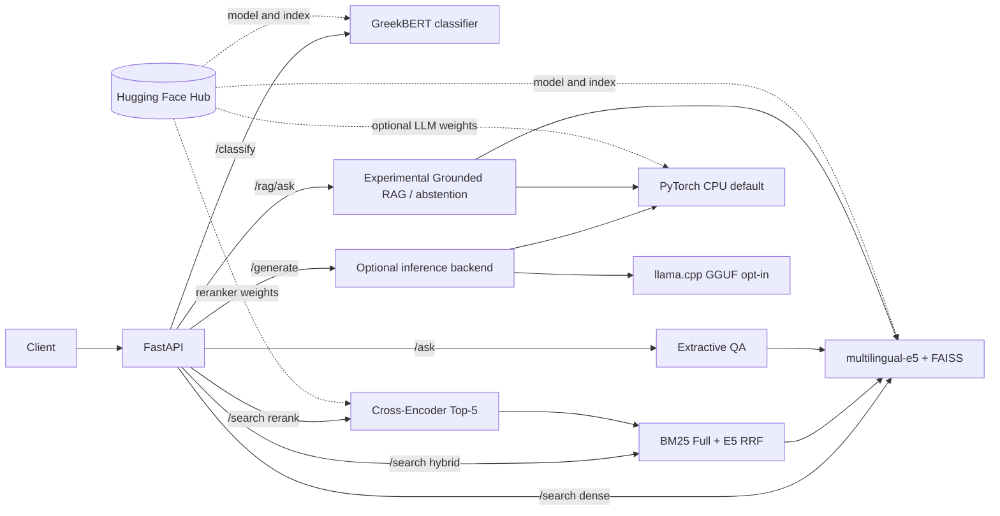

# Greek News NLP API

[](https://github.com/P-Tilemachos/Greek-News-NLP-API/actions/workflows/ci.yml)


A research-oriented REST API for **Greek news understanding** using fine-tuned GreekBERT, semantic and hybrid search, cross-encoder reranking, extractive question answering, and optional LLM generation. Implemented with **FastAPI**, packaged with **Docker**, and checked with **GitHub Actions**. Model artifacts and the search index are distributed separately through the Hugging Face Hub.

> **Project status:** Phases 11–18 have been implemented and evaluated. The current package version observed in Phase 18 is `0.1.0`; **no production readiness or v2.0.0 release is claimed**. Grounded generative RAG (`/rag/ask`) is **experimental**: its safety guard works in observed probes, but over-abstention persists even for a known-answerable question. See [Phase 18 release assessment](docs/phase_18_release_assessment.md).

## Highlights

- **Greek news classification.** A fine-tuned GreekBERT predicts 17 IPTC categories. On 788 held-out articles, it reached **0.825 accuracy / 0.770 macro-F1**, compared with **0.753 / 0.667** for a TF-IDF + Logistic Regression baseline. Labels were automatically assigned, not independently human-verified.
- **LLM benchmarking.** Comparisons against zero-shot Qwen2.5 (1.5B, 3B) and QLoRA-tuned Qwen2.5-1.5B on the test set. GreekBERT achieved the best reported macro-F1; see [benchmark protocol and caveats](docs/benchmarks.md).
- **Retrieval.** Dense multilingual-e5 + FAISS, BM25 + dense hybrid fusion (RRF), and Top-5 cross-encoder reranking. On a synthetic 480-query evaluation, later-sentence Recall@1 rose from **0.31 (dense)** to **0.50 (hybrid)** to **0.71 (reranked)**; these numbers are not a human-query relevance benchmark.
- **Question answering.** `/ask` extracts source-grounded passages; the correct reference article appeared among returned sources for **38/40 answerable questions (95%)** in the recorded exploratory evaluation. `/rag/ask` supports citations and conservative abstention, but is **not quality-validated** for generated answers.
- **LLM inference.** PyTorch generation through `/generate`, plus optional localhost llama.cpp/GGUF support. Phase 16 includes CPU latency, memory, and streaming experiments with explicitly stated limitations.
- **Engineering and validation.** **204/204 local pytest tests passed**, together with Ruff lint and format checks, in the Phase 18 run (2 November 2026). Phase 17 added contract/regression tests, coverage reporting and release smoke checks. Phase 18 included real-model/API probes for classification, retrieval, extractive QA, generation and RAG; **functional PASS is not an accuracy or security certification**.

## Architecture



## Results

Classification on the 788-article test split (17 IPTC Media Topic categories). Macro-F1 is the main metric because the classes are imbalanced (sport has about 900 articles, weather about 30).

| Model | Accuracy | Macro-F1 |
|---|---|---|
| TF-IDF + Logistic Regression (baseline) | 0.753 | 0.667 |
| **GreekBERT (fine-tuned)** | **0.825** | **0.770** |

The fine-tuned model is published on the Hugging Face Hub with a model card: [Tilemachos-P/greek-news-classifier](https://huggingface.co/Tilemachos-P/greek-news-classifier).

LLM benchmark on the same test articles (GreekBERT was re-evaluated in this run, which gave 0.834 / 0.775; see the [benchmark report](docs/benchmarks.md) for the difference):

| Model | Accuracy | Macro-F1 |
|---|---|---|
| GreekBERT (fine-tuned) | **0.834** | **0.775** |
| Qwen2.5-1.5B + QLoRA | 0.777 | 0.696 |
| Qwen2.5-3B, zero-shot | 0.629 | 0.518 |
| Qwen2.5-1.5B, zero-shot | 0.486 | 0.402 |

Confidence intervals, latency, VRAM and caveats are in [docs/benchmarks.md](docs/benchmarks.md).

## Phase 15 — Grounded RAG evaluation (exploratory)

The local saved-prediction evaluation of `POST /rag/ask` used `Qwen/Qwen2.5-1.5B-Instruct` on CPU and **40 author-reviewed answerable questions** plus **40 provisional unanswerable candidates**. Two cases served as development pilots; results for the other 78 were also reported separately. All 80 abstentions were reviewed by the author, **not** by an independent or blinded evaluation team.

| Metric | 78 cases (excluding pilots) | All 80 cases |
|---|---:|---:|
| Saved predictions | 78 / 78 | 80 / 80 |
| Answers generated | **0 / 78** | **0 / 80** |
| Abstentions | 78 / 78 (100%) | 80 / 80 (100%) |
| Answerable questions answered | 0 / 39 (0%) | 0 / 40 (0%) |
| Correct reference article among returned sources | 37 / 39 (94.87%) | 38 / 40 (95.00%) |
| Author-reviewed records | Included in the 80-case review | 80 / 80 |

**Finding: severe over-abstention.** Retrieval often found the expected document, but the generator produced no answers. Document-ID overlap alone does **not** demonstrate that the answer-bearing passage was available to the generator or that a citation supports an answer. In one development example, the album title `Moss` appeared verbatim in retrieved evidence and the pipeline still abstained.

Because **no answers were generated**, answer correctness, citation faithfulness and hallucination rates are **N/A**, not zero. Negative-case labels remain provisional; some author-review decisions are uncertain, and the two pilot cases are not held-out. The 78-case saved-prediction report may show `human_reviewed: 0` because it was scored separately; the 80-case review contains the author annotations.

The evaluation workflow passed **86 local pytest tests and Ruff lint** on 1 November 2026. Those checks validate evaluation code, **not** generation quality. Predictions, source excerpts and review records remain excluded from Git. See the [Phase 15 protocol and limitations](docs/phase_15_rag_evaluation.md).

## Phase 16 — CPU inference performance and optional GGUF backend

Phase 16 compared HTTP end-to-end CPU inference on a **single development-only Greek `/generate` prompt**, using one warm-up and three measured requests per configuration. The original PyTorch model remains the default; a llama.cpp/GGUF backend is an **explicit opt-in for `/generate` only**. Grounded `/rag/ask` still uses PyTorch and its known quality issues were not solved by these backend experiments.

| Configuration | Median HTTP latency | Observed peak server RSS | Notes |
|---|---:|---:|---|
| PyTorch CPU, Qwen2.5-1.5B-Instruct | 25.21 s | 6,002.13 MiB | FP32 baseline |
| llama.cpp, Qwen2.5-1.5B-Instruct GGUF Q4_K_M | 2.79 s | 1,156.09 MiB | ~9.04× lower median latency for this prompt |
| llama.cpp, Llama-Krikri-8B-Instruct GGUF Q4_K_M | 11.14 s | 4,841.20 MiB | Different, Greek-focused model |

All configurations generated **48 output tokens** in the matched workload. RSS denotes a sampled Windows **working-set approximation** for already-loaded processes, **not** unique model RAM, startup peak or system memory. Results combine a backend change with different weight formats; they do **not** isolate quantization effects.

A Qwen GGUF streaming probe reported **57.93 ms median first-visible-content latency** and **2.37 s median full streamed response latency**. First-visible-content timing is not necessarily internal model TTFT and can benefit from prompt caching. A provisional synthetic eight-case Greek quality screen for Krikri yielded **7/8 acceptable** responses; one failed conflict handling by making an unsupported certainty claim. This is not a comprehensive or independently adjudicated quality benchmark.

The local opt-in HTTP integration returned a successful response with a Krikri model ID. The Phase 16 suite passed 132 local tests and Ruff checks, and [GitHub CI #46](https://github.com/P-Tilemachos/Greek-News-NLP-API/actions/workflows/ci.yml) passed `test` and `docker` jobs on `main` (1 November 2026). These automated checks **do not establish real-model answer quality**.

### Optional llama.cpp backend (local development)

First, install llama.cpp and obtain the model, then start its server **on loopback only** in a separate terminal:

```bat
llama serve -hf ilsp/Llama-Krikri-8B-Instruct-GGUF:Q4_K_M --host 127.0.0.1 --port 9931 -t 8 -c 2048 -ngl 0
```

In another Windows Command Prompt or Anaconda Prompt, configure FastAPI:

```bat
set "LLM_BACKEND=llamacpp"
set "LLAMACPP_BASE_URL=http://127.0.0.1:9931"
set "LLAMACPP_MODEL_MATCH=Krikri"
python -m uvicorn greek_nlp.api.main:app --host 127.0.0.1 --port 8001
```

The `/generate` schema is unchanged. Without `LLM_BACKEND=llamacpp`, the original PyTorch generator is used. This optional backend needs a separately running llama.cpp service. A successful FastAPI `/health` does **not** verify it is available. **Do not expose the unauthenticated local LLM server publicly** without suitable authentication, network restrictions and deployment controls. Check model-specific license terms independently of the MIT code license.

See [Phase 16 experimental results](docs/phase_16_results.md) and [optional llama.cpp integration](docs/phase_16_optional_llamacpp_integration.md).

## Phase 17 — API regression testing and CI hardening

Phase 17 expanded the test suite and introduced reproducible release-oriented checks:

- **API contracts:** `/health`, OpenAPI schema, documented routes and invalid-request validation.
- **Regression tests:** mocked endpoint behavior for classification, dense/hybrid/reranked search, extractive QA, grounded RAG and generation/backends. Mocks keep these CI tests fast, but cannot establish real-model quality.
- **CI:** Ruff lint and formatting, pytest with coverage/JUnit reports, Docker build, and HTTP smoke validation. Coverage was **75%** in the recorded Phase 17 baseline; this is not a claim about the current overall coverage after Phase 18 changes.
- **Release smoke:** `/health` and `/openapi.json` return successful responses, while deliberately malformed generation and RAG requests return expected validation errors (`422`).

The Phase 17.4 GitHub Actions workflow [run #50](https://github.com/P-Tilemachos/Greek-News-NLP-API/actions) was reported successful on `main`. See [CI hardening](docs/phase_17_3_ci_hardening.md) and [release smoke validation](docs/phase_17_4_release_validation.md).

## Phase 18 — Real-model validation and RAG safety

Local live-model/API probes were performed against a running FastAPI server. These are **functional sanity checks**, not independently reviewed benchmarks.

| Component | Phase 18 observation | Qualification |
|---|---|---|
| `/classify` — GreekBERT | PASS | Returned a valid real-model prediction; no new accuracy claim |
| `/search` — dense, hybrid, rerank | PASS | Real retrieval/index and reranker exercised; relevance not human-reviewed |
| `/ask` — extractive QA | PASS | Valid extractive response; not a full answer-quality evaluation |
| `/generate` — PyTorch | PASS | Generated non-empty output; factuality not verified |
| `/rag/ask` — grounded RAG | Technical PASS; quality **not passed** | Grounding/safety guards can abstain, but answerable questions remain unanswered |
| Local automated suite | **204 tests passed** | Plus Ruff lint and formatting on 2 November 2026 |

**Known RAG limitation.** A Phase 15 exploratory review recorded **80/80 abstentions**. In Phase 18, a known-answerable question about disciplinary responsibility for the Mandra floods retrieved a relevant evidence excerpt (article `macocu.el.9211668`) but returned **`Answer: None`**. A broad flood question also abstained. The output guard prevented a malformed answer from being shown, while the **over-abstention and unverified citation faithfulness remain unresolved**. The broader safety and licensing checks have not been approved.

The report [Phase 18 — Release Assessment](docs/phase_18_release_assessment.md) records the evidence and outstanding release gates. Do not interpret HTTP 200, a citation, or `faithfulness_verified: false` as a measure of factual correctness.

**Release decision:** implementation and technical validation are documented, but **production/v2 release approval is pending** independent RAG quality review (or explicit feature exclusion), licensing obligations, deployment security, and final CI confirmation for the intended release commit.

## API

| Endpoint | Description |
|---|---|
| `GET /health` | API liveness check; does not verify model or index readiness |
| `POST /classify` | Top-k predicted categories with scores for a Greek text |
| `POST /search` | Dense E5/FAISS by default; opt-in `mode: "hybrid"` (BM25 + E5 + RRF) or `mode: "rerank"` (hybrid + Cross-Encoder Top-5) |
| `POST /ask` | Extractive question answering: the most relevant sentences with article ids, plus the source articles |
| `POST /rag/ask` | **Experimental** grounded generation with citations and conservative abstention; generated-answer quality not approved |
| `POST /generate` | Bounded **ungrounded** generation: PyTorch by default; opt-in local llama.cpp/GGUF (Phase 16) |

Example `/classify` request:
```json
{

  "text": "Η κυβέρνηση ανακοίνωσε νέα μέτρα στήριξης για τους αγρότες λόγω των πλημμυρών",

  "top_k": 3

}
```
Example `/search` request with hybrid retrieval:
```json
{"query": "πλημμύρες και αποζημιώσεις αγροτών", "k": 5, "mode": "hybrid"}
```
Omitting `mode` keeps dense-only search. Interactive documentation (Swagger) is available at `/docs` when the server is running.

## Demo

Screenshots of the API running locally (Swagger UI).


## Quickstart

Use Python 3.11 inside an activated virtual or Conda environment:
```bash
git clone https://github.com/P-Tilemachos/Greek-News-NLP-API.git

cd Greek-News-NLP-API

python -m pip install -e ".[dev,ml]"
```
Configure the public Hugging Face repositories and start the API.

**Windows (Command Prompt / Anaconda Prompt):**
```bat
set "HF_MODEL_REPO=Tilemachos-P/greek-news-classifier"

set "HF_INDEX_REPO=Tilemachos-P/greek-news-index"

python -m uvicorn greek_nlp.api.main:app --reload
```
**Linux / macOS (Bash):**
```bash
export HF_MODEL_REPO=Tilemachos-P/greek-news-classifier

export HF_INDEX_REPO=Tilemachos-P/greek-news-index

python -m uvicorn greek_nlp.api.main:app --reload
```
Open [Swagger UI](http://127.0.0.1:8000/docs) to try the endpoints. The first request to each component may take longer while its artifacts are downloaded and loaded. Initial downloads require internet access.

Model weights and the search index are not stored in this repository. They are loaded from `models_store/` (`greek-bert-news-classifier/` and `rag_index/`). If a folder is missing, the API downloads it from the Hugging Face Hub, using these environment variables:

| Variable | Purpose |
|---|---|
| `HF_MODEL_REPO` | Hub repository containing the fine-tuned classifier |
| `HF_INDEX_REPO` | Hub repository containing the FAISS index and article texts |
| `HF_TOKEN` | Access token, only needed for private repositories |
| `MODELS_DIR` | Optional: custom location of the local model store |

The index can be rebuilt locally with `python -m greek_nlp.rag.retriever` after running the data notebooks.

## Docker

Run these commands from the repository root with Docker running:
```bash
docker build -t greek-news-nlp-api .

docker run --rm -p 8000:8000 -e HF_MODEL_REPO=Tilemachos-P/greek-news-classifier -e HF_INDEX_REPO=Tilemachos-P/greek-news-index greek-news-nlp-api
```
This example does not mount persistent storage, so downloaded artifacts inside the container are removed when it is deleted. The classifier ([greek-news-classifier](https://huggingface.co/Tilemachos-P/greek-news-classifier)) and the search index ([greek-news-index](https://huggingface.co/datasets/Tilemachos-P/greek-news-index)) are public on the Hugging Face Hub, so no token is needed.

## Tests and CI

Install the development dependencies (`python -m pip install -e ".[dev]"`) before running checks:
```bash
python -m pytest -q
python -m ruff check .
python -m ruff format --check .
python -m pip check
```
Coverage and machine-readable test reports:
```bash
python -m pytest -q --cov=greek_nlp --cov-report=term-missing:skip-covered --cov-report=xml:coverage.xml --junitxml=test-results.xml
```
**Most recent locally shared Phase 18 validation:** 204 passing tests with no Ruff lint/format errors. The test suite emphasizes API contracts, mocked inference and regression checks; it does not require downloading model weights during CI. **Real-model checks are separate**, require the relevant models/index and local resources, and do not run as proof of model correctness in the standard CI workflow.

GitHub Actions runs on pushes to `main` and pull requests. Its `test` job runs lint/format checks, pytest and reporting; the `docker` job builds the image and checks HTTP liveness/validation behavior. The project has successfully completed prior CI runs; the **final Phase 18 commit (`2d47398`) should be checked in Actions before release approval**, rather than inferring its outcome from the local tests.

Local real-model and review scripts:
```bash
# Start the API in a separate terminal first.
python scripts/phase18_real_model_validation.py --probe classify --timeout 300 --report phase18-classify.json
python scripts/phase18_final_rag_review.py --show-answers --timeout 600
```
Local Phase 18 JSON reports and private review data should not be committed to Git. The final RAG review demonstrates current limitations, not a passing answer-quality gate.

## Documentation

- [LLM and GPU inference benchmarks](docs/benchmarks.md)
- [Retrieval evaluation: dense, hybrid and reranking](docs/retrieval.md)
- [Extractive QA evaluation](docs/qa_evaluation.md)
- [Phase 15 — Grounded RAG exploratory evaluation](docs/phase_15_rag_evaluation.md)
- [Phase 16 — CPU/GGUF results and limitations](docs/phase_16_results.md) and [optional llama.cpp integration](docs/phase_16_optional_llamacpp_integration.md)
- [Phase 17 — CI hardening](docs/phase_17_3_ci_hardening.md) and [release validation](docs/phase_17_4_release_validation.md)
- [Phase 18 — Final validation and release assessment](docs/phase_18_release_assessment.md)
- Integration guides: [hybrid search](docs/phase_11_hybrid_integration.md), [reranking](docs/phase_12_reranking_integration.md), [local LLM generation](docs/phase_13_local_llm_integration.md)
- [Reproducing the experiments](docs/reproducing.md) and [full list of limitations](docs/limitations.md)

## Project structure

```
src/greek_nlp/

  api/       FastAPI app and request/response schemas

  core/      model and index download from the Hugging Face Hub

  models/    GreekBERT inference

  rag/       Dense FAISS, hybrid retrieval, reranking, extractive QA and grounded RAG

  evaluation/  Offline grounded RAG scorer and review import/export

  llm/       PyTorch generator and optional llama.cpp HTTP backend

notebooks/   experiments and offline reporting notebooks

scripts/     collection, reporting and developer utilities

evaluation/  public schema and run-metadata templates (not private review data)

results/     local benchmark/evaluation outputs (keep private run artifacts out of Git)

docs/        screenshots, reports and integration guides

tests/       pytest contract, regression, safety and release validation checks

Dockerfile   CPU image of the API
```

## Data

[EMMediaTopic 1.0](http://hdl.handle.net/11356/1991) (Kuzman and Ljubešić, Jožef Stefan Institute), Greek subset: 5,250 news articles, licensed under CC BY-SA 4.0. The data files are not stored in this GitHub repository. The article texts are included in the search index dataset on the Hugging Face Hub ([greek-news-index](https://huggingface.co/datasets/Tilemachos-P/greek-news-index)), which is distributed under the same CC BY-SA 4.0 license. Re-split 70/15/15 (stratified, seed 42) into train, validation and test.

## Limitations

- **Labels:** The classification labels were assigned automatically by GPT-4o. Reported metrics measure agreement with these labels, not verified human ground truth. Rare categories have small test counts, so per-class scores are noisy.
- **Context length:** Classification and dense embeddings use a maximum of 256 tokens.
- **Retrieval evaluation:** Frozen, automatically generated source-excerpt queries are not representative of independent real-world user questions. Benchmark improvements do not demonstrate production relevance quality.
- **Grounded RAG:** The Phase 15 exploratory set showed 80/80 abstentions; Phase 18 still abstained on a known-answerable Mandra query despite returning relevant evidence. Its conservative output guard rejects malformed generation, but **answer quality, groundedness and citation faithfulness are not independently validated**. Negative labels in the earlier evaluation remain provisional; the author reviews were not blinded.
- **Generation:** `/generate` is ungrounded and may produce incorrect content. The Phase 16 CPU/GGUF performance and Greek-quality experiments were small development screens, not isolated or independently replicated benchmarks. llama.cpp must remain loopback-restricted unless deployment protections are added.
- **Reproducibility:** The identity of the re-evaluated GreekBERT checkpoint versus the historical one remains unresolved. Certain model comparisons were single runs.
- **Security and licenses:** MIT applies to the repository's code, not automatically to the training corpus, model weights or other assets. Production authentication, rate limiting, resource controls, secret management and third-party license compliance require a separate review.
- **Deployment:** No public live demo is currently available; a previous Hugging Face Spaces attempt was limited by free-tier CPU quota. This repository is **not certified production-ready**.

See [docs/limitations.md](docs/limitations.md) and the [Phase 18 release assessment](docs/phase_18_release_assessment.md).

## Roadmap

### Completed — Implementation and validation work

- [x] Data preprocessing, stratified splitting and TF-IDF baseline.
- [x] GreekBERT fine-tuning, classification evaluation and `/classify` API.
- [x] Dense multilingual-e5 / FAISS retrieval and extractive `/ask`.
- [x] Docker packaging, automated tests, GitHub Actions CI and Hugging Face model card.
- [x] Open-source LLM benchmarking and controlled Tesla T4 inference evaluation.
- [x] Offline BM25, dense E5, hybrid RRF and cross-encoder reranking evaluations.
- [x] Extractive QA evaluation with 40 answerable questions (Notebook 10).
- [x] **Phase 11:** Opt-in hybrid retrieval for `/search`.
- [x] **Phase 12:** Opt-in cross-encoder reranking for `/search`.
- [x] **Phase 13:** Local open-source generation via `/generate`.
- [x] **Phase 14:** Grounded RAG endpoint `/rag/ask` with citations, safe retry and abstention support (not quality-certified).
- [x] **Phase 15:** Exploratory RAG evaluation, 80 saved predictions and transparent over-abstention reporting.
- [x] **Phase 16:** CPU/GGUF latency and memory experiments, streaming checks and optional local llama.cpp backend.
- [x] **Phase 17:** API contract/regression tests, CI hardening, coverage and release smoke validation; CI #50 passed.
- [x] **Phase 18:** Real-model/API sanity probes, RAG evidence and output-guard refinements, **204 local passing tests**, and final release assessment. The known-answerable RAG case still abstained; quality approval was **not** achieved.

### Open release gates (not yet completed)

- [ ] Confirm final CI status for Phase 18 commit and reconcile uncommitted documentation changes.
- [ ] Review license terms for the article corpus, model weights, and redistributed artifacts separately from the MIT code license.
- [ ] Complete deployment security review (authentication, rate limits, resource controls, secrets and external LLM service restrictions).
- [ ] Independently review a held-out QA set and verify answer correctness, appropriate abstention and citation support; alternatively exclude experimental RAG from the approved release scope.
- [ ] Approve release scope and version; create a GitHub release/tag only after the gates above are met.

### Planned improvements

- [ ] Reconcile historical GreekBERT checkpoints and improve reproducibility of model comparisons.
- [ ] Build overlapping passage-level indexing and assess evidence extraction/retrieval against human-reviewed questions.
- [ ] Improve over-abstention without weakening citation or safety checks; independently validate answerability and faithfulness.
- [ ] Deploy a public live demo when hosting resources and security controls permit.
