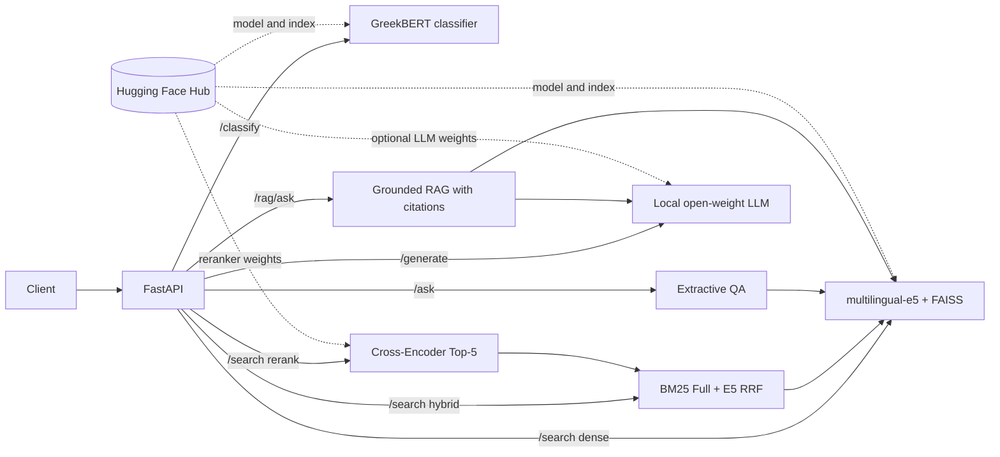

# Greek News NLP API

[](https://github.com/P-Tilemachos/Greek-News-NLP-API/actions/workflows/ci.yml)


A REST API for Greek news: topic classification with a fine-tuned **GreekBERT**, semantic search (dense, hybrid and reranked), extractive question answering with cited evidence, and grounded generative answers. Built with FastAPI, packaged with Docker and tested in CI. The repository also documents the experiments behind it: a benchmark of GreekBERT against zero-shot and QLoRA fine-tuned LLMs, and several retrieval evaluations.

## Highlights

- **Classification.** Fine-tuned GreekBERT on 17 IPTC topics reaches 0.825 accuracy and 0.770 macro-F1 on 788 test articles, against 0.753 / 0.667 for a TF-IDF baseline.
- **LLM comparison.** Benchmarked against zero-shot Qwen2.5 (1.5B, 3B) and a QLoRA fine-tuned Qwen2.5-1.5B on the same test set. GreekBERT scored highest (+8.3 macro-F1 points over QLoRA, 95% bootstrap CI +3.2 to +14.1) and had the lowest latency in a single-request T4 benchmark.
- **Retrieval.** Dense search (multilingual-e5 + FAISS), hybrid search (BM25 + dense with Reciprocal Rank Fusion) and Top-5 cross-encoder reranking, evaluated on 480 frozen synthetic queries. On later-sentence queries, Recall@1 rises from 0.31 (dense) to 0.50 (hybrid) and 0.71 (with reranking).
- **Question answering.** The extractive `/ask` endpoint returns the source article at rank 1 for 95% of 40 answerable questions. `/rag/ask` adds grounded generative answers with citations and abstention; its faithfulness evaluation is still planned.
- **Engineering.** FastAPI, Docker image, GitHub Actions (lint, format check, tests, Docker build with a health check), and models and index hosted on the Hugging Face Hub and loaded lazily.
- **Documented limitations.** Every benchmark records its protocol and caveats (automatic GPT-4o labels, synthetic queries, single runs).

## Architecture



## Results

Classification on the 788-article test split (17 IPTC Media Topic categories). Macro-F1 is the main metric because the classes are imbalanced (sport has about 900 articles, weather about 30).

| Model | Accuracy | Macro-F1 |
|---|---|---|
| TF-IDF + Logistic Regression (baseline) | 0.753 | 0.667 |
| **GreekBERT (fine-tuned)** | **0.825** | **0.770** |

The fine-tuned model is published on the Hugging Face Hub with a model card: [Tilemachos-P/greek-news-classifier](https://huggingface.co/Tilemachos-P/greek-news-classifier).

LLM benchmark on the same test articles (GreekBERT was re-evaluated in this run, which gave 0.834 / 0.775; see the [benchmark report](docs/benchmarks.md) for the difference):

| Model | Accuracy | Macro-F1 |
|---|---|---|
| GreekBERT (fine-tuned) | **0.834** | **0.775** |
| Qwen2.5-1.5B + QLoRA | 0.777 | 0.696 |
| Qwen2.5-3B, zero-shot | 0.629 | 0.518 |
| Qwen2.5-1.5B, zero-shot | 0.486 | 0.402 |

Confidence intervals, latency, VRAM and caveats are in [docs/benchmarks.md](docs/benchmarks.md).

## API

| Endpoint | Description |
|---|---|
| `GET /health` | API liveness check; does not verify model or index readiness |
| `POST /classify` | Top-k predicted categories with scores for a Greek text |
| `POST /search` | Dense E5/FAISS by default; opt-in `mode: "hybrid"` (BM25 + E5 + RRF) or `mode: "rerank"` (hybrid + Cross-Encoder Top-5) |
| `POST /ask` | Extractive question answering: the most relevant sentences with article ids, plus the source articles |
| `POST /rag/ask` | Grounded generative answer with source citations and abstention |
| `POST /generate` | Optional ungrounded local text generation with a bounded open-source LLM |

Example `/classify` request:

```json
{
  "text": "Η κυβέρνηση ανακοίνωσε νέα μέτρα στήριξης για τους αγρότες λόγω των πλημμυρών",
  "top_k": 3
}
```

Example `/search` request with hybrid retrieval:

```json
{"query": "πλημμύρες και αποζημιώσεις αγροτών", "k": 5, "mode": "hybrid"}
```

Omitting `mode` keeps dense-only search. Interactive documentation (Swagger) is available at `/docs` when the server is running.

## Demo

Screenshots of the API running locally (Swagger UI).


## Quickstart

Use Python 3.11 inside an activated virtual or Conda environment:

```bash
git clone https://github.com/P-Tilemachos/Greek-News-NLP-API.git
cd Greek-News-NLP-API
python -m pip install -e ".[dev,ml]"
```

Configure the public Hugging Face repositories and start the API.

**Windows (Command Prompt / Anaconda Prompt):**

```bat
set "HF_MODEL_REPO=Tilemachos-P/greek-news-classifier"
set "HF_INDEX_REPO=Tilemachos-P/greek-news-index"
python -m uvicorn greek_nlp.api.main:app --reload
```

**Linux / macOS (Bash):**

```bash
export HF_MODEL_REPO=Tilemachos-P/greek-news-classifier
export HF_INDEX_REPO=Tilemachos-P/greek-news-index
python -m uvicorn greek_nlp.api.main:app --reload
```

Open [Swagger UI](http://127.0.0.1:8000/docs) to try the endpoints. The first request to each component may take longer while its artifacts are downloaded and loaded. Initial downloads require internet access.

Model weights and the search index are not stored in this repository. They are loaded from `models_store/` (`greek-bert-news-classifier/` and `rag_index/`). If a folder is missing, the API downloads it from the Hugging Face Hub, using these environment variables:

| Variable | Purpose |
|---|---|
| `HF_MODEL_REPO` | Hub repository containing the fine-tuned classifier |
| `HF_INDEX_REPO` | Hub repository containing the FAISS index and article texts |
| `HF_TOKEN` | Access token, only needed for private repositories |
| `MODELS_DIR` | Optional: custom location of the local model store |

The index can be rebuilt locally with `python -m greek_nlp.rag.retriever` after running the data notebooks.

## Docker

Run these commands from the repository root with Docker running:

```bash
docker build -t greek-news-nlp-api .
docker run --rm -p 8000:8000 -e HF_MODEL_REPO=Tilemachos-P/greek-news-classifier -e HF_INDEX_REPO=Tilemachos-P/greek-news-index greek-news-nlp-api
```

This example does not mount persistent storage, so downloaded artifacts inside the container are removed when it is deleted. The classifier ([greek-news-classifier](https://huggingface.co/Tilemachos-P/greek-news-classifier)) and the search index ([greek-news-index](https://huggingface.co/datasets/Tilemachos-P/greek-news-index)) are public on the Hugging Face Hub, so no token is needed.

## Tests and CI

```bash
python -m pytest -q
python -m ruff check .
python -m ruff format --check .
```

The test suite covers API responses and input validation using mocked inference components, plus artifact download path handling using a simulated Hub download. Tests do not download model weights or require a Hugging Face token. CI runs on pushes to `main` and pull requests, with separate jobs for lint, formatting, tests, and a Docker image build with a `/health` smoke test. These checks do not establish real-model inference quality.

## Documentation

- [LLM and GPU inference benchmarks](docs/benchmarks.md)
- [Retrieval evaluation: dense, hybrid and reranking](docs/retrieval.md)
- [Extractive QA evaluation](docs/qa_evaluation.md)
- Integration guides: [hybrid search](docs/phase_11_hybrid_integration.md), [reranking](docs/phase_12_reranking_integration.md), [local LLM generation](docs/phase_13_local_llm_integration.md)
- [Reproducing the experiments](docs/reproducing.md)
- [Full list of limitations](docs/limitations.md)

## Project structure

```
src/greek_nlp/
  api/       FastAPI app and request/response schemas
  core/      model and index download from the Hugging Face Hub
  models/    GreekBERT inference
  rag/       Dense FAISS, BM25/E5 Hybrid RRF, lazy Cross-Encoder Top-5 reranking and extractive QA
notebooks/   experiments and API smoke-test notebooks
results/     benchmark, retrieval, reranking and QA evaluation outputs
docs/        screenshots, reports and integration guides
tests/       pytest suite (models are mocked, so CI needs no weights)
Dockerfile   CPU image of the API
```

## Data

[EMMediaTopic 1.0](http://hdl.handle.net/11356/1991) (Kuzman and Ljubešić, Jožef Stefan Institute), Greek subset: 5,250 news articles, licensed under CC BY-SA 4.0. The data files are not stored in this GitHub repository. The article texts are included in the search index dataset on the Hugging Face Hub ([greek-news-index](https://huggingface.co/datasets/Tilemachos-P/greek-news-index)), which is distributed under the same CC BY-SA 4.0 license. Re-split 70/15/15 (stratified, seed 42) into train, validation and test.

## Limitations

- Labels were assigned automatically by GPT-4o, so classification metrics measure agreement with those labels, not verified human ground truth.
- Rare categories (weather, lifestyle and leisure, religion) have very few test examples, so their per-class scores are noisy.
- Classification and dense embeddings use a maximum sequence length of 256 tokens.
- The retrieval evaluations use automatically generated, source-excerpt queries. Full-text BM25 matches them perfectly, and this does not generalize to real user questions.
- `/ask` is extractive and has no answerability threshold. `/rag/ask` faithfulness has not been evaluated yet, and `/generate` output is ungrounded.
- The LLM benchmark is a single run per model on one dataset, and the identity of the re-evaluated GreekBERT checkpoint relative to the historical one is unresolved.
- There is no public live demo (a Hugging Face Spaces attempt was blocked by the free-tier CPU quota).

The full list is in [docs/limitations.md](docs/limitations.md).

## Roadmap

Done: data cleaning and splits, TF-IDF baseline, GreekBERT fine-tuning, `/classify`, dense `/search`, extractive `/ask`, Docker and CI, Hugging Face model card, LLM benchmark with bootstrap confidence intervals, controlled T4 inference benchmark, hybrid and reranked retrieval (offline evaluation and opt-in `/search` modes), extractive QA evaluation, `/generate`, and grounded `/rag/ask`.

Planned:

- [ ] Reconcile the historical GreekBERT checkpoint and results, and standardize matched-input comparisons
- [ ] Public live demo
- [ ] Chunked retrieval to index the full text of each article
- [ ] Human-assessed queries to validate retrieval relevance before making hybrid the default
- [ ] Faithfulness, hallucination and answerability evaluation for `/rag/ask`
- [ ] Quantization, streaming and inference performance with controlled comparisons
- [ ] End-to-end API tests, regression CI and v2 release checks

## License

The code is released under the MIT License (see `LICENSE`). The classifier is fine-tuned from [GreekBERT](https://huggingface.co/nlpaueb/bert-base-greek-uncased-v1) (MIT License, Copyright (c) 2020 NLP AUEB Group). The article texts in the index dataset are licensed under CC BY-SA 4.0 (see [Data](#data)). The LLM benchmark evaluates Qwen2.5 models (Alibaba Cloud), which are not redistributed here; see their model cards for license terms.
