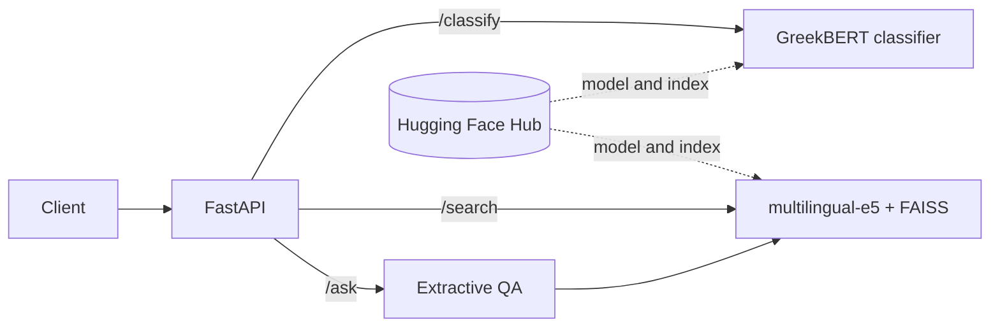

# Greek News NLP API


Greek news classification and retrieval-based extractive question answering served through a REST API: a fine-tuned **GreekBERT** classifier (evaluated against a TF-IDF baseline), semantic search with multilingual-e5 and FAISS, and an extractive `/ask` endpoint that returns cited evidence sentences. Packaged with Docker and tested in CI. The repository also contains a [benchmark of open-source LLMs](#llm-benchmark) (zero-shot and QLoRA fine-tuned) against the GreekBERT classifier.

## Architecture



## Results

Original classification results on the 788-article test split (17 IPTC Media Topic categories). The classifier was trained on the training split, with model selection on validation. Subsequent LLM experiments also used this test split; their evaluation history is documented below.

| Model | Accuracy | Macro-F1 |
|---|---|---|
| TF-IDF + Logistic Regression (baseline) | 0.753 | 0.667 |
| **GreekBERT (fine-tuned)** | **0.825** | **0.770** |

Macro-F1 is the main metric because the classes are imbalanced (sport has about 900 articles, weather about 30). The fine-tuned model is published on the Hugging Face Hub with a model card: [Tilemachos-P/greek-news-classifier](https://huggingface.co/Tilemachos-P/greek-news-classifier).


*Confusion matrix of the TF-IDF baseline on the validation set.*

## LLM Benchmark

Does an open-weight LLM beat a fine-tuned GreekBERT on Greek news topic classification (17 IPTC topics)? The final comparison below uses the same 788 test articles for four model configurations, with matching document IDs and reference labels. Prompt variants and QLoRA epochs were compared on the validation split (787 articles).

**Evaluation history:** an initial free-generation smoke test used 100 articles sampled from the test split before the subsequent prompting experiments. The full test split was then used for the final comparison. It was therefore not completely untouched during development. The confidence intervals below describe sampling uncertainty on this test set; they do not account for possible bias from its earlier use.

### Test-set results

| Model | Accuracy (95% CI) | Macro-F1 (95% CI) | s/article* | Peak VRAM* |
|---|---|---|---|---|
| GreekBERT (fine-tuned) | **0.834** (0.810–0.860) | **0.775** (0.731–0.811) | 0.016 | 1.6 GB |
| Qwen2.5-1.5B + QLoRA | 0.777 (0.746–0.806) | 0.696 (0.639–0.732) | 0.252 | 3.6 GB |
| Qwen2.5-3B, zero-shot | 0.629 (0.596–0.665) | 0.518 (0.473–0.554) | 0.472 | 8.4 GB |
| Qwen2.5-1.5B, zero-shot | 0.486 (0.452–0.520) | 0.402 (0.351–0.438) | 0.245 | 5.1 GB |

95% confidence intervals come from 1,000 bootstrap resamples of the test set. GreekBERT minus QLoRA: +5.8 points accuracy (CI +2.9 to +8.8) and +8.3 points macro-F1 (CI +3.2 to +14.1).

GreekBERT was re-evaluated on the same test articles as the LLMs, using `text_clean`, a 256-token limit and batch size 8. This run gives 0.834 / 0.775, compared with the historical 0.825 / 0.770 in [Results](#results). The difference is unresolved: checkpoint identity, preprocessing, data versions and inference settings need to be compared before attributing a cause. The new figures are reported as a separate evaluation, not as an established model improvement.

\*Historical measurements on Colab T4, batch 8. GreekBERT and reloaded QLoRA timings cover synchronized forward passes on validation; the final zero-shot timings include tokenization, device transfer, forward passes and prediction extraction on test. No consistent warm-up protocol was used. VRAM is peak PyTorch allocated memory, not total device memory, and isolation from other live tensors was not verified. These figures are indicative and are not a controlled latency or memory comparison. Seconds per article at batch 8 is amortized processing time, not single-request API latency.

### Findings

- **The tested QLoRA configuration improved classification.** It lifted the 1.5B model by about 29 percentage points in both accuracy and macro-F1 and beat the 3B zero-shot configuration. Prompt format, article length and precision also differ, so this is not an isolated ablation of fine-tuning alone.
- **GreekBERT achieved the highest classification scores in this comparison.** Its historical timing and memory measurements were also lower, but a controlled performance comparison is still needed. The experiment does not isolate why it outperforms QLoRA.
- **The tested few-shot setup did not improve validation accuracy** (0.485 vs 0.510 zero-shot). It used one training example per class and about 7,000 prompt tokens per article. Few-shot was not evaluated in the final test comparison; this result does not establish that other example selections or prompting strategies would fail.
- **Output format matters for small LLMs.** Asking for a letter (A to Q) collapsed to a single answer (validation accuracy 0.056). Scoring the first token of each label name worked. Scoring full label strings gave no gain on a 200-article validation subset and was roughly an order of magnitude slower.
- **Weak classes.** The QLoRA model is weakest on `conflict, war and peace` (validation F1 0.40 vs 0.67 for GreekBERT) and `lifestyle and leisure` (0.18 vs 0.43, but only 8 validation examples, too few for a reliable estimate).

### Method

- **Zero-shot:** Qwen2.5-1.5B-Instruct and Qwen2.5-3B-Instruct, both loaded in FP16 (the 3B run was not 4-bit). The prompt lists the 17 labels and the prediction is the label whose first token has the highest logit, so there are no unparseable outputs. Articles are truncated to 1,200 characters.
- **QLoRA:** Qwen2.5-1.5B-Instruct in 4-bit NF4, LoRA r=16 on all attention and MLP projections, 2 epochs, learning rate 2e-4, effective batch size 16, loss on the answer tokens only, articles truncated to 800 characters, one training run, 118 minutes on a T4. Seed 42 was set in the training cell after adapter initialization, so the initial LoRA weights were not controlled by that seed. No hyperparameter search. The epoch was chosen on the validation split.
- **GreekBERT:** the saved fine-tuned classifier from Google Drive, re-evaluated on the same test articles. Its checkpoint identity relative to the published API model has not been verified.
- **Input budgets:** GreekBERT uses 256 tokens, zero-shot Qwen uses 1,200 characters and QLoRA uses 800 characters. These are configuration comparisons, not comparisons under equal input budgets.
- **Training-loop limitation:** the saved QLoRA run uses floor division for batches and steps. With 3,675 examples, batch size 4 and accumulation 4, three examples are omitted and gradients from the last two full batches are not applied at each epoch end. Future runs should handle both remainders. The reported metrics remain those of the original run.
- Notebook: [`notebooks/05_llm_benchmark.ipynb`](notebooks/05_llm_benchmark.ipynb). Metrics and test-set predictions (identifiers and labels only, no article text): [`results/`](results/).

### Limitations of the benchmark

One dataset, one run per model, no QLoRA hyperparameter search, and no fine-tuned 3B model. Labels were assigned automatically by GPT-4o (see [Limitations](#limitations)), so the metrics measure agreement with those labels. The initial test-subset smoke experiment, differing input budgets and measurement protocols limit the comparison. Bootstrap intervals do not measure variability across training seeds. Dependencies and model revisions were not pinned. TF-IDF remains a historical baseline and is not included in the four-model paired bootstrap comparison. A cost-per-1,000-requests estimate has not been produced. The conclusions apply to these configurations and this dataset, not to LLMs in general.

## Retrieval evaluation

Semantic search over the 5,250 Greek articles uses `intfloat/multilingual-e5-small` and a FAISS index. Each article is encoded with the `passage: ` prefix and a maximum sequence length of 256 tokens. Two sets of 300 queries were constructed automatically from sampled articles (seed 42); these are not a benchmark of real user questions.

| Query type | Recall@1 | Recall@5 | Recall@10 | MRR@10 |
|---|---|---|---|---|
| Opening of the article (sanity check, near-verbatim) | 0.997 | 1.000 | 1.000 | 0.998 |
| Sentence sampled after the first 200 whitespace-separated words | 0.327 | 0.463 | 0.530 | 0.386 |

The second evaluation uses sentences sampled after the first 200 whitespace-separated words of articles containing at least 260 words. It is more challenging than the near-verbatim opening queries. However, this word-based selection does not guarantee that every query is fully outside the first 256 tokens embedded by the model. Only the original source article counts as relevant; other articles covering the same event are not credited. These results measure source-article retrieval, not answer correctness.

The retrieval corpus includes all three classification splits as a searchable knowledge base. The classifier is trained only on the training split; retrieval evaluation is a separate task.

## API

| Endpoint | Description |
|---|---|
| `GET /health` | API liveness check; does not verify model or index readiness |
| `POST /classify` | Top-k predicted categories with scores for a Greek text |
| `POST /search` | Semantic search over the article index, returns the top-k articles |
| `POST /ask` | Extractive question answering: the most relevant sentences with article ids, plus the source articles |

Example `/classify` request:

```json
{
  "text": "Η κυβέρνηση ανακοίνωσε νέα μέτρα στήριξης για τους αγρότες λόγω των πλημμυρών",
  "top_k": 3
}
```

Interactive documentation (Swagger) is available at `/docs` when the server is running.

## Demo

Screenshots of the API running locally (Swagger UI).


## Quickstart

Use Python 3.11 inside an activated virtual or Conda environment:

```bash
git clone https://github.com/P-Tilemachos/Greek-News-NLP-API.git
cd Greek-News-NLP-API
python -m pip install -e ".[dev,ml]"
```

Configure the public Hugging Face repositories and start the API.

**Windows — Command Prompt / Anaconda Prompt:**

```bat
set "HF_MODEL_REPO=Tilemachos-P/greek-news-classifier"
set "HF_INDEX_REPO=Tilemachos-P/greek-news-index"
python -m uvicorn greek_nlp.api.main:app --reload
```

**Linux / macOS — Bash:**

```bash
export HF_MODEL_REPO=Tilemachos-P/greek-news-classifier
export HF_INDEX_REPO=Tilemachos-P/greek-news-index
python -m uvicorn greek_nlp.api.main:app --reload
```

Open [Swagger UI](http://127.0.0.1:8000/docs) to try the endpoints. The first request to each component may take longer while its artifacts are downloaded and loaded. Semantic search also loads `intfloat/multilingual-e5-small` from the Hub. Initial downloads require internet access.

Model weights and the search index are not stored in this repository. They are loaded from `models_store/` (`greek-bert-news-classifier/` and `rag_index/`). If a folder is missing, the API downloads it from the Hugging Face Hub, using these environment variables:

| Variable | Purpose |
|---|---|
| `HF_MODEL_REPO` | Hub repository containing the fine-tuned classifier |
| `HF_INDEX_REPO` | Hub repository containing the FAISS index and article texts |
| `HF_TOKEN` | Access token, only needed for private repositories |
| `MODELS_DIR` | Optional: custom location of the local model store |

The index can be rebuilt locally with `python -m greek_nlp.rag.retriever` after running the data notebooks.

## Docker

Run these commands from the repository root with Docker running. The single-line commands work in Bash and Windows Command Prompt / Anaconda Prompt:

```bash
docker build -t greek-news-nlp-api .
docker run --rm -p 8000:8000 -e HF_MODEL_REPO=Tilemachos-P/greek-news-classifier -e HF_INDEX_REPO=Tilemachos-P/greek-news-index greek-news-nlp-api
```

This example does not mount persistent storage, so downloaded artifacts inside the container are removed when it is deleted.

The trained classifier and the search index are public on the Hugging Face Hub: [greek-news-classifier](https://huggingface.co/Tilemachos-P/greek-news-classifier) (model) and [greek-news-index](https://huggingface.co/datasets/Tilemachos-P/greek-news-index) (dataset). No token is needed to download them. For the reproduction workflow, see below.

## Tests and CI

```bash
python -m pytest -q
python -m ruff check .
python -m ruff format --check .
```

The test suite covers API responses and input validation using mocked inference components, plus artifact download path handling and local-folder reuse using a simulated Hub download. Tests do not download model weights or require a Hugging Face token.

CI runs on pushes to `main` and pull requests. Separate jobs run lint, formatting checks and tests, and build the Docker image with a `/health` smoke test. These checks do not establish real-model inference quality or model readiness. Models and the index load lazily on first use.

## Reproducing the experiments

1. Download EMMediaTopic 1.0 from the source linked in [Data](#data) and place `EMMediaTopic-1.0.jsonl` in `data/`.
2. Install notebook dependencies in addition to the API dependencies: `python -m pip install jupyter pandas scikit-learn matplotlib seaborn accelerate`.
3. Run `01_eda.ipynb` and `02_baseline.ipynb` from the `notebooks/` directory to create the splits and evaluate the baseline.
4. Run `03_finetune_greekbert.ipynb` in a GPU-enabled Colab environment. It uses Google Drive paths: upload the split files and adapt `DATA_DIR` to your location. The notebook uses FP16 training.
5. Copy the saved classifier folder to `models_store/greek-bert-news-classifier/`, or upload it to a Hugging Face model repository and configure `HF_MODEL_REPO`.
6. From the repository root, run `python -m greek_nlp.rag.retriever` to build the index from `data/el_train.jsonl`, `data/el_val.jsonl` and `data/el_test.jsonl`.
7. Run `04_retrieval_eval.ipynb` to evaluate retrieval. The index folder can be uploaded to a Hugging Face **dataset** repository and used through `HF_INDEX_REPO`.
8. Run `05_llm_benchmark.ipynb` in a GPU-enabled Colab environment (a T4 is enough). It reads the split files and the fine-tuned classifier from Google Drive paths that need to be adapted, and installs `transformers`, `peft` and `bitsandbytes`. The QLoRA adapters are not stored in this repository; the resulting metrics and predictions are in `results/`.

Dependencies are not currently locked to exact versions. Library versions and hardware can affect reproducibility; the reported metrics are the saved outputs of the included notebooks.

## Project structure

```
src/greek_nlp/
  api/       FastAPI app and request/response schemas
  core/      model and index download from the Hugging Face Hub
  models/    GreekBERT inference
  rag/       embedding retriever (FAISS) and extractive QA
notebooks/   01 EDA, 02 TF-IDF baseline, 03 GreekBERT fine-tuning (Colab), 04 retrieval evaluation, 05 LLM benchmark (Colab)
results/     LLM benchmark metrics and test-set predictions (no article text)
docs/        screenshots and project plan
tests/       pytest suite (models are mocked, so CI needs no weights)
Dockerfile   CPU image of the API
```

## Data

[EMMediaTopic 1.0](http://hdl.handle.net/11356/1991) (Kuzman and Ljubešić, Jožef Stefan Institute), Greek subset: 5,250 news articles, licensed under CC BY-SA 4.0. The data files are not stored in this GitHub repository. The article texts are included in the search index dataset on the Hugging Face Hub ([greek-news-index](https://huggingface.co/datasets/Tilemachos-P/greek-news-index)), which is distributed under the same CC BY-SA 4.0 license. Re-split 70/15/15 (stratified, seed 42) into train, validation and test.

## Limitations

- The labels were assigned automatically by GPT-4o, not by human annotators. Classification metrics therefore measure agreement with these automatic labels, rather than verified human ground truth. Annotation errors and ambiguities may affect both training and evaluation.
- Rare categories (weather, lifestyle and leisure, religion) have very few test examples, so their per-class scores are noisy.
- Test-set performance varies by category, with lower F1 scores for *lifestyle and leisure* and *society*.
- Classification and article embedding use a maximum sequence length of 256 tokens. Later text does not contribute directly to article retrieval, although `/ask` can select sentences from the full text of articles that were retrieved.
- Training uses a class-weighted loss to address imbalance. Its effect was not isolated through an unweighted GreekBERT comparison.
- `/ask` is extractive: it selects sentences from the retrieved articles and does not generate text. Some selected sentences can be scraping leftovers such as "read also" teasers.
- The retrieval evaluation uses automatically generated queries, not real user questions. `/ask` answer quality has not been evaluated separately.
- `/ask` returns the highest-ranked candidate sentences without an answerability threshold. Ambiguous or unsupported questions may therefore return related but unhelpful evidence.
- The article corpus is static and is not a live news feed. Retrieval scores are similarity scores, not calibrated probabilities of correctness.
- The LLM benchmark is a single run per model on one dataset; see its own limitations above.

## Roadmap

- [x] Data exploration, cleaning and stratified split
- [x] TF-IDF baseline
- [x] GreekBERT fine-tuning and test-set evaluation
- [x] `/classify` endpoint with tests and CI
- [x] Semantic retrieval with `/search`, evaluated with Recall@k and MRR
- [x] Extractive `/ask` endpoint returning cited evidence sentences
- [x] Dockerfile and Docker build check in CI
- [x] Model card on the Hugging Face Hub
- [x] Initial LLM benchmark: zero-shot and QLoRA vs GreekBERT on test with bootstrap confidence intervals; few-shot experiments on validation
- [ ] Benchmark follow-up: standardize performance measurements, reconcile GreekBERT results and improve training reproducibility
- [ ] Public live demo (attempted on Hugging Face Spaces, blocked by the free-tier CPU quota)
- [ ] Chunked retrieval (overlapping passages) to index the full text of each article
- [ ] Hybrid retrieval (BM25 + dense) with a reranker, evaluated with Recall@k and MRR
- [ ] Generative `/ask` with an open-source LLM, evaluated for faithfulness against the extractive version
- [ ] Quantized LLM serving with streaming and evaluation regression tests in CI

## License

The code is released under the MIT License (see `LICENSE`). The classifier is fine-tuned from [GreekBERT](https://huggingface.co/nlpaueb/bert-base-greek-uncased-v1) (MIT License, Copyright (c) 2020 NLP AUEB Group). The article texts in the index dataset are licensed under CC BY-SA 4.0 (see [Data](#data)). The LLM benchmark evaluates Qwen2.5 models (Alibaba Cloud), which are not redistributed here; see their model cards for license terms.
